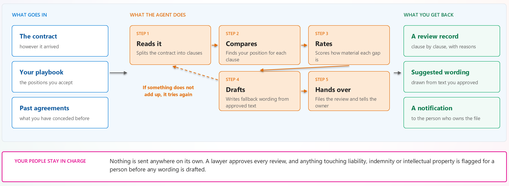

# Contract Review with GitHub Copilot Harness - Overview

**Scenario Type:** Legal Operations / Contract Review  
**Agent Type:** Copilot Studio agent using GitHub Copilot Harness  
**Primary Components:** Approved contract sources, negotiation standards, read-only tools, a contract-review skill, and a controlled review workflow  
**Complexity:** Advanced  
**Official product guidance checked:** 2026-10-11

## Scenario Overview

Help legal teams review contracts against approved negotiation standards and focus their attention on exceptions.

The agent gathers the relevant contract and standards, compares clauses by meaning rather than text alone, identifies deviations, and prepares a review package with traceable findings and approved fallback wording.

GitHub Copilot Harness coordinates the multi-step analysis inside Copilot Studio. It can adapt the analysis plan when documents are incomplete, sources conflict, or an authorized retrieval step fails.

Qualified counsel remains responsible for legal interpretation and decisions. The agent does not approve, execute, sign, or send an agreement.

This scenario is not a GitHub coding-agent workflow.

## Product Scope

The GitHub Copilot harness is a Copilot Studio authoring and orchestration framework, not the GitHub Copilot service. It shares underlying technology and SDK components with GitHub Copilot, but Copilot Studio agent data isn't sent to or processed by that service. Existing Copilot Studio privacy, security, compliance, and data residency commitments apply; confirm the requirements of each connected source and selected capability.

Choose the harness when creating a new agent. Existing agents can't be transferred between the GitHub Copilot and standard harnesses. Standard harness agents remain supported and can also use reasoning, tools, and retries; choose this harness for the required scale, context, and adaptive coordination, not merely because the task involves a contract.

The read-only tool boundary, mandatory counsel review, and prohibition on signing are controls required by this reference design, not automatic product restrictions. Some capabilities have feature-specific preview documentation, including natural-language authoring, created files, memory, and MCP integration. Confirm their current status and required channels before deployment.

## Problem Statement

Contract review becomes a bottleneck when reviewers must repeatedly:

- Locate relevant clauses across long documents and attachments.
- Compare wording with organizational standards.
- Distinguish an acceptable variation from a material deviation.
- Find approved fallback language.
- Assemble a consistent, reviewable record.

Simple text matching is insufficient when clauses use different wording to express similar obligations. Unconstrained generation is also unsuitable because proposed positions must remain within approved standards.

## Solution Summary

The agent:

1. Confirms the contract, organizational scope, jurisdiction, and applicable standards.
2. Retrieves authorized contract content and approved reference material.
3. Builds a clause inventory and analysis plan.
4. Compares clauses with the applicable standards.
5. Produces evidence-linked findings and permitted fallback wording.
6. Identifies missing evidence, conflicting sources, and unresolved questions.
7. Hands a versioned draft to qualified counsel.

A separate workflow handles draft intake, internal reviewer notification, approval, and any permitted downstream review-record update. Contract execution and signature are outside this scenario.

## First-Pass Review Illustrated

The figure shows the business process, not an authorization model. In this design, filing and internal notification belong to the controlled workflow, not to unrestricted agent tools. Past agreements are optional historical context; a previous concession doesn't become an approved standard or fallback.

Under the example legal policy, liability, indemnity, and intellectual property clauses go to counsel before replacement wording is drafted. Legal owns this rule and its configuration; it is not a built-in harness restriction.

## Review Package

| Logical artifact | Required content |
|---|---|
| Review summary | Scope, contract and standards versions, draft status, major exceptions, and recommended review tasks. |
| Clause register | Every in-scope clause, its source location, classification, and coverage state. |
| Deviation register | Differences, legal-owned severity, supporting evidence, and approved fallback or an explicit withholding reason. |
| Source manifest | Retrieved source identifiers, versions, extraction coverage, and unavailable attachments or sections. |
| Counsel queue | Findings needing review, assigned role, required decision, and unresolved questions. |

These can be sections of one package or separate documents/tables. Agree the format with legal and the builder; the artifact names aren't product APIs. See the [worked fixture and output](4.Sample-prompts.md#worked-fixture-and-output) for a concrete, synthetic example.

## Why GitHub Copilot Harness

Use the harness when the review requires adaptive coordination across documents and tools:

- Different contract structures require different analysis paths.
- Missing attachments or conflicting standards require clarification.
- Clause relationships require contextual comparison.
- Recoverable retrieval failures may require a revised plan.
- The final package combines findings, evidence, exceptions, and review tasks.

Use a simpler workflow when the task is a fixed checklist over predictable inputs.

## Scope and Boundaries

### In Scope

- Clause and obligation identification.
- Comparison with approved, versioned standards.
- Classification of deviations using a legal-owned taxonomy.
- Draft fallback wording drawn from approved alternatives.
- A structured review package and counsel review queue.

### Out of Scope

- Independent legal advice or legal strategy.
- Determining enforceability or legal effect.
- Creating a new negotiation position without legal approval.
- Approving, signing, executing, or externally sending an agreement.
- Accessing documents outside the requester's authorized scope.

Unreadable or unsupported documents must be routed to an approved extraction process or returned as blocked. The agent must not infer missing text.

## Target Users and Ownership

| Role | Responsibility |
|---|---|
| Contract counsel | Owns standards, legal interpretation, and review decisions. |
| Contract manager | Supplies the review request and resolves missing business inputs. |
| Agent builder | Implements the agent, tools, skill, and output validation. |
| Platform administrator | Configures the environment and authorized connections. |
| Operator | Monitors failures, review queues, and operational performance. |

## Business Outcomes and Measures

Establish a baseline before the pilot.

| Measure | Intended improvement |
|---|---|
| Review preparation time | Reduce time spent locating and assembling evidence. |
| Evidence coverage | Make every finding traceable to the contract and applicable standard. |
| Missed material deviations | Measure against a qualified reviewer's assessment. |
| Reviewer correction rate | Identify unreliable classification or fallback suggestions. |
| Unauthorized actions | Require zero unapproved consequential actions. |

Set acceptance thresholds with legal and operational owners. These are proposed measures, not achieved results.

## Deliverable Status

This reference design does not include an exported agent, configured connectors, a workflow package, or executed acceptance evidence.

Tenant capability, integration behavior, and operational readiness must be established before production use.

---

## Related Resources

Public product documentation checked on 2026-10-11. This scenario is an illustrative implementation, not a Microsoft-provided legal agent or a production certification.

| Resource | Link |
|---|---|
| Architecture | [2.Architecture.md](2.Architecture.md) |
| Step-by-Step Runbook | [3.Runbook.md](3.Runbook.md) |
| Sample Prompts | [4.Sample-prompts.md](4.Sample-prompts.md) |
| GitHub Copilot Harness Execution | [Pattern Overview](../../02-patterns/GitHub-Copilot-Harness-Execution/GitHub-Copilot-Harness-Execution.md) |
| Harnesses in Copilot Studio | [Microsoft Learn](https://learn.microsoft.com/en-us/microsoft-copilot-studio/harnesses-overview) |
| GitHub Copilot Harness Agent Overview | [Microsoft Learn](https://learn.microsoft.com/en-us/microsoft-copilot-studio/agents-experience/overview) |
| Compare Copilot Studio Agent Harnesses | [Microsoft Learn](https://learn.microsoft.com/en-us/microsoft-copilot-studio/guidance/choose-harness) |
