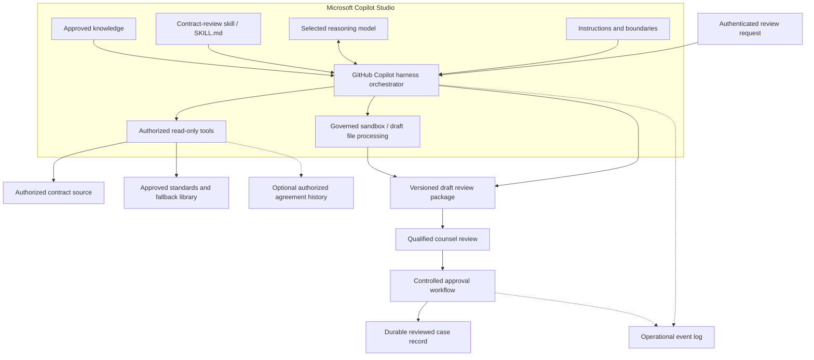
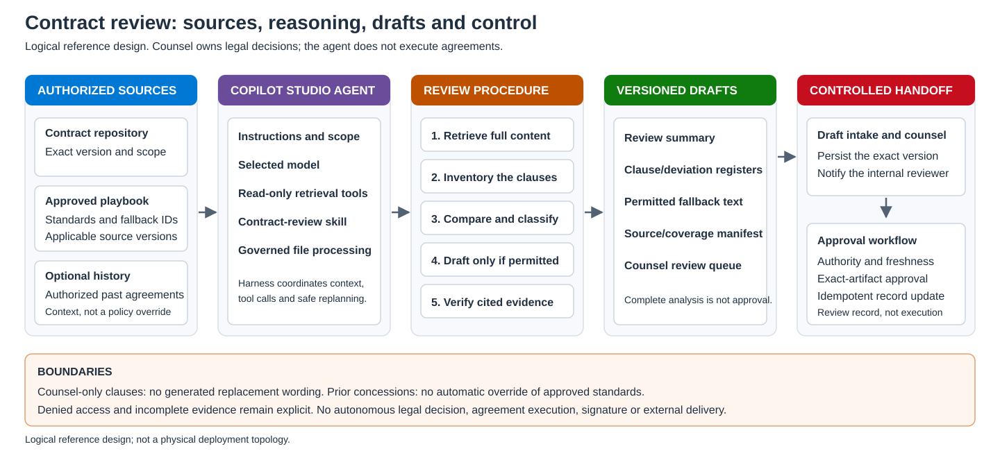
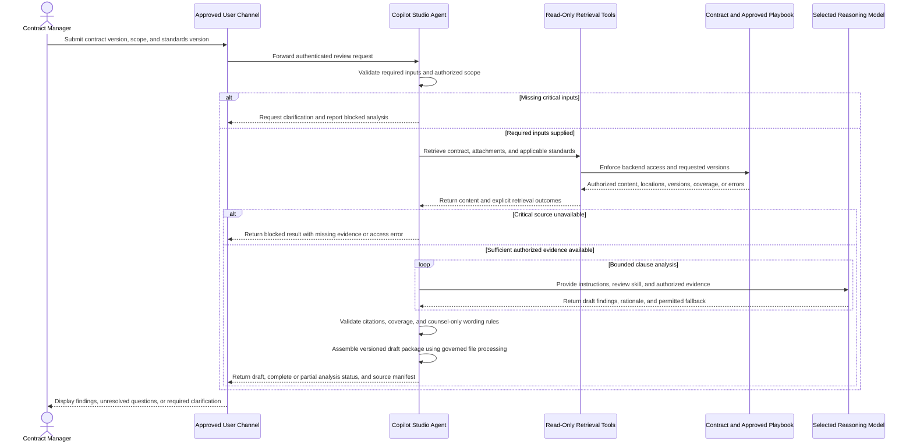
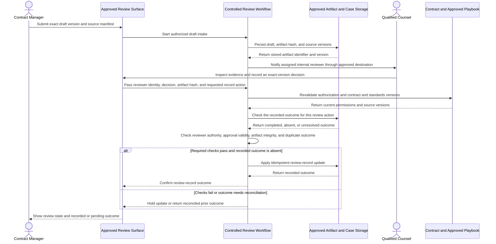
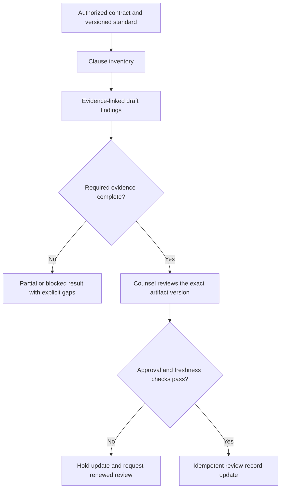

# Contract Review with GitHub Copilot Harness - Architecture

## Logical Architecture

Original logical diagram grounded in the public [agent overview](https://learn.microsoft.com/en-us/microsoft-copilot-studio/agents-experience/overview) and [harness documentation](https://learn.microsoft.com/en-us/microsoft-copilot-studio/harnesses-overview). The component names describe responsibilities, not built-in API names, a physical deployment topology, or a deployable configuration.

The selected model supplies reasoning; the harness manages context and tool calls. Copilot Studio governs the task sandbox. This diagram doesn't assert a tenant-only network topology or permanent sandbox storage.

## Component Responsibilities

| Component | Responsibility | Scenario configuration |
|---|---|---|
| Agent instructions | Define scope, prohibited actions, uncertainty handling, and escalation. | Contract type, jurisdiction, source precedence, counsel-only clauses, and no agreement execution. |
| Selected model | Supply reasoning and generation. | Select against representative contract-review quality, latency, and consumption. |
| GitHub Copilot Harness | Coordinate context, tool use, and bounded replanning. | Retrieve, compare, verify, and hand off without expanding the authorized scope. |
| Contract-review skill | Package Markdown instructions and optional resources. | `contract-review-against-playbook`, with the agreed clause taxonomy and output requirements. |
| Approved knowledge | Ground analysis in configured sources. | Legal-owned negotiation standards and approved fallback text with applicable versions. |
| Governed sandbox | Process supported files and create draft artifacts. | Prepare draft documents/registers, not a permanent legal archive. |
| Read-only tools | Retrieve authorized content with source metadata. | Full contract, standards, approved alternatives, and optional authorized agreement history. |
| Review package | Preserve findings, evidence, versions, exceptions, and draft status. | Summary, clause/deviation registers, source manifest, and counsel queue. |
| Approval workflow | Enforce reviewer authority and control permitted record updates. | Draft intake, internal notification, exact-version review, and idempotent case-record update. |

A skill provides procedural guidance. It does not enforce authorization or replace workflow controls.

Read-only tools, exact-version approval, source revalidation, output validation, and idempotency must be implemented for this scenario. They aren't guarantees obtained by selecting a harness. A workflow can enforce an authored control path, but generated content from an AI action still requires validation.

## Scenario Component Map

The agent prepares evidence and permitted draft wording, while the workflow owns persistence and internal notification. Agreement execution and signature are outside this design.

## Data Flow

The following sequences show the logical movement of request metadata, authorized source content, draft artifacts, and review decisions. Tool interfaces and workflow controls must be implemented in the target environment.

### Scenario A - Contract Review Request

Unavailable optional evidence remains visible in a partial result. Missing critical sources block the analysis. Any additional retrieval or retry stays within the authorized scope and configured limits; a model response cannot grant access or override a denial.

### Scenario B - Counsel Review and Record Update

The review surface can be implemented with a [Copilot Studio Workflow Request for information](https://learn.microsoft.com/en-us/microsoft-copilot-studio/workflows-experience/flows-request-for-information) or a separate approved review system. The sequence abstracts both paths; native RFI pauses the workflow for Outlook input from same-tenant reviewers and uses the first response only, not all-reviewers approval.

| Step | Actor | Action |
|---|---|---|
| 1 | Contract manager | Supplies the contract version, scope, applicable standards, and requested review. |
| 2 | Agent | Validates inputs and requests authorized read-only retrieval; missing critical inputs require clarification. |
| 3 | Retrieval tools and source systems | Enforce access and return content, source versions, locations, coverage, and explicit errors. |
| 4 | Agent and selected model | Compare clauses using the review skill and authorized evidence; withhold replacement wording for counsel-only categories. |
| 5 | Agent | Validates findings and returns a versioned draft with a separate complete, partial, or blocked analysis state. |
| 6 | Review workflow | Accepts the submitted draft into approved storage and notifies only the assigned internal reviewer. |
| 7 | Qualified counsel | Inspects the exact artifact and evidence, then records the review decision. |
| 8 | Review workflow and source systems | Revalidate authority, approval, artifact integrity, source freshness, and duplicate protection before any permitted record update. |
| 9 | Review workflow and storage | Record the authorized review outcome, or hold/reconcile the update and expose its actual state. |

The agent never receives consequential write credentials. A complete analysis is still a draft, and a review-record update is not agreement approval, execution, signature, or external delivery. Operational logs capture permitted run metadata and outcomes under the applicable retention policy; optional memory is not the artifact or approval store.

## Input Contract

Require:

- Contract identifier and immutable version or content hash.
- Contract type.
- Organizational and jurisdictional scope.
- Applicable review date or period.
- Approved standard-position library and version.
- Authorized source scope.
- Requested output and designated reviewer role.

Ask for missing critical inputs before substantive analysis. Do not silently choose a jurisdiction or substitute a different standard.

Retrieval must establish document coverage. Search snippets or a knowledge answer alone don't prove that every clause, schedule, and attachment was read. Use an authorized full-content retrieval or extraction path and record omissions.

## Review Method

Use a legal-owned classification scheme, for example:

- `MATCHES_STANDARD`
- `APPROVED_FALLBACK`
- `DEVIATION`
- `RED_LINE`
- `ABSENT`
- `NEEDS_REVIEW`

Semantic similarity may support analysis, but it does not authorize the agent to determine legal equivalence. Ambiguous or conflicting interpretations require counsel review.

For the example legal policy, classify liability, indemnity, and intellectual property clauses as `RED_LINE` for mandatory counsel handling and withhold agent-generated replacement wording. Legal may define a different or wider clause list before acceptance testing. Historical agreements never override the applicable approved standards without a legal-owned precedence rule.

## Output Contract

Each finding should contain:

| Field | Required content |
|---|---|
| Finding identifier | Stable identifier within the review. |
| Clause | Contract quotation and section/page location. |
| Applicable standard | Standard identifier, version, and location. |
| Classification | A value from the approved taxonomy. |
| Rationale | The observed difference and its relationship to the standard. |
| Severity | A value from the legal-owned risk taxonomy. |
| Proposed fallback | Approved wording and its reference, "No approved fallback found," or `withheld_pending_counsel` with no generated text. |
| Exceptions | Missing evidence, conflicts, extraction limitations, or uncertainty. |
| Review state | Draft, pending review, approved, or rejected. |

The package also records contract version, standards version, creation time, configuration version, and reviewer assignment.

Only an independently enforced review workflow or review system may record approved or rejected states, not the agent's inference. It may run inside Copilot Studio using [native human review](https://learn.microsoft.com/en-us/microsoft-copilot-studio/workflows-experience/flows-request-for-information); "independent" doesn't require a product outside Copilot Studio. Validate the human response before recording a decision.

Keep analysis completeness separate from review approval. A complete clause inventory can still contain deviations and counsel-only findings; it doesn't mean the agreement is compliant or approved. The [worked output example](4.Sample-prompts.md#worked-fixture-and-output) makes this distinction explicit.

## Evidence and Approval Flow

This original diagram illustrates the controls specified in this design. A review-record update is not contract approval, execution, signature, or external delivery.

## Identity and Approval Boundaries

Backend systems enforce document access. A tool connection must not expose more information than the authorized requester and task require.

Where a service identity is used, document its scope and implement requester-level authorization rather than relying on prompts.

An authenticated agent request doesn't establish a tool's execution identity. [Maker-provided credentials](https://learn.microsoft.com/en-us/microsoft-copilot-studio/configure-no-maker-authentication) can access a source as the connection owner instead of the requester. Complete a tool-by-tool credential record; the following is an illustrative scope map, not configured connections:

| Logical operation | Identity record required | Enforced scope |
|---|---|---|
| Retrieve contract and attachments | Actual end-user connection or scoped service identity, plus requester authorization. | The requested contract/version and permitted attachments only. |
| Retrieve standards and approved fallback | Actual connection owner/service identity and source permissions. | Applicable, approved library versions; no library modification. |
| Retrieve optional history | Actual connection identity and requester-level history access. | Only authorized agreements; history doesn't override approved policy. |
| Draft intake, notification, and review-record update | Separate workflow/review-system identity and trusted reviewer identity. | Approved storage, internal recipient, and exact permitted record action; no signing or external delivery. |

Use [tool management](https://learn.microsoft.com/en-us/microsoft-copilot-studio/agents-experience/tools-manage) to remove unneeded connector actions and disable individual MCP tools. Enforcing end-user credentials has [environment-wide and background-run implications](https://learn.microsoft.com/en-us/microsoft-copilot-studio/configure-no-maker-authentication#scope-of-enforcement-and-experience); test the chosen invocation path rather than assuming every tool inherits the user's sign-in.

Keep consequential write credentials outside agent-accessible tools. The approval workflow binds approval to:

- Reviewer identity and authority.
- Exact artifact version or hash.
- Contract and standards versions.
- Permitted action and destination.
- Approval expiration.

Any artifact change invalidates the approval. Material source changes require renewed review.

These are custom implementation requirements. Persist the immutable artifact, approval decision, action key/payload hash, and outcome ledger described in the [shared approval storage contract](../../02-patterns/GitHub-Copilot-Harness-Execution/GitHub-Copilot-Harness-Execution-Runbook.md#custom-approval-and-action-records). Implement backend uniqueness and conditional writes; don't treat a native Workflow human response as an automatic artifact lock or exactly-once guarantee.

Contract execution and signature remain outside this implementation.

## Artifact and Memory Boundaries

If the channel accepts [user attachments](https://learn.microsoft.com/en-us/microsoft-copilot-studio/agents-experience/attachments-overview), each file is limited to 16 MiB. A failed attachment is skipped while the rest of the message continues. Match accepted files against an expected contract/attachment manifest: a missing mandatory attachment blocks dependent analysis, while an optional gap remains explicit in a partial result. This limit doesn't apply universally to documents retrieved through backend tools.

[Files created by the agent](https://learn.microsoft.com/en-us/microsoft-copilot-studio/agents-experience/created-files-overview) have a 10 MB per-file limit and are retained in the conversation for 28 days after its last activity. An oversized file isn't surfaced to the user. Split large review packages and make missing outputs explicit.

Use an independently authorized intake or review workflow to persist the exact draft, source versions, and approval record in approved storage. A conversation file card is not a permanent legal archive.

Optional [Memory](https://learn.microsoft.com/en-us/microsoft-copilot-studio/agents-experience/memory-overview) retains user-specific context, not an authoritative contract version, approval ledger, or transactional recovery checkpoint. This design doesn't depend on memory being enabled.

## Failure and Recovery

| Condition | Required behavior |
|---|---|
| Missing contract or standard | Block analysis and request the required input. |
| Permission denied | Stop the affected retrieval; never bypass the denial. |
| Temporary tool failure | Retry within configured limits or use an approved equivalent source. |
| Hook failure or time-out | The [native Hook](https://learn.microsoft.com/en-us/microsoft-copilot-studio/agents-experience/hooks-overview#things-to-know) may let the agent continue; backend access checks and mandatory write gates must still reject invalid requests. |
| Conflicting standards | Surface the conflict and request legal resolution. |
| Partial extraction | Mark affected clauses as unreviewed; do not fill gaps. |
| Mandatory user attachment skipped | Block dependent analysis or use an independently authorized retrieval path; never mark the full review complete. |
| Contract changes during review | Create a new review version and invalidate stale approval. |
| Interrupted run | Resume only if durable state and revalidation are implemented; otherwise start a linked new run. |
| Workflow waiting for counsel | [Native RFI](https://learn.microsoft.com/en-us/microsoft-copilot-studio/workflows-experience/flows-request-for-information) can resume on a human response; revalidate sources, artifact integrity, and approval validity before any update. |

An alternate source is acceptable only when independently authorized and approved for the same purpose.

## Operational Records

Record observable tool calls, outcomes, source versions, errors, latency, and available usage data.

Do not require hidden model reasoning. Protect contract content in logs and retain records according to the applicable policy.

---

## Related Resources

Public product documentation checked on 2026-10-11. Diagrams describe the logical reference design, not a deployable configuration or a physical security topology.

| Resource | Link |
|---|---|
| Scenario Overview | [1.Overview.md](1.Overview.md) |
| Step-by-Step Runbook | [3.Runbook.md](3.Runbook.md) |
| Sample Prompts | [4.Sample-prompts.md](4.Sample-prompts.md) |
| Harnesses in Copilot Studio | [Microsoft Learn](https://learn.microsoft.com/en-us/microsoft-copilot-studio/harnesses-overview) |
| Skills Overview for Agents | [Microsoft Learn](https://learn.microsoft.com/en-us/microsoft-copilot-studio/agents-experience/skills-overview) |
| Workflows Overview | [Microsoft Learn](https://learn.microsoft.com/en-us/microsoft-copilot-studio/workflows-experience/flows-overview) |
| Workflow Human Review | [Microsoft Learn](https://learn.microsoft.com/en-us/microsoft-copilot-studio/workflows-experience/flows-request-for-information) |
| Hooks and Failure Behavior | [Microsoft Learn](https://learn.microsoft.com/en-us/microsoft-copilot-studio/agents-experience/hooks-overview) |
| Control Maker-Provided Credentials | [Microsoft Learn](https://learn.microsoft.com/en-us/microsoft-copilot-studio/configure-no-maker-authentication) |
| Manage Tool Actions | [Microsoft Learn](https://learn.microsoft.com/en-us/microsoft-copilot-studio/agents-experience/tools-manage) |
| User Attachment Limits | [Microsoft Learn](https://learn.microsoft.com/en-us/microsoft-copilot-studio/agents-experience/attachments-overview) |
