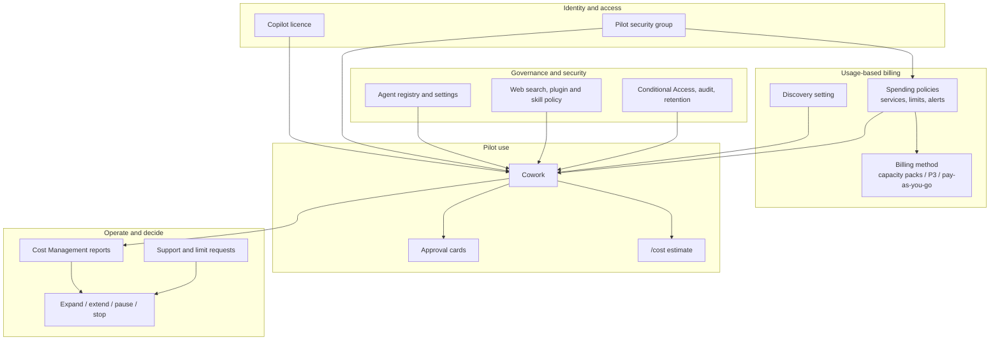
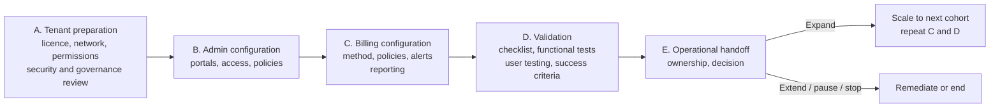

# Cowork Enablement Pilot - Architecture

There is no custom solution to deploy. The "architecture" is the set of **control planes**
that govern a Cowork pilot, who owns each one, and the order in which they must be closed.

## Control Planes

A user can use Cowork only when the **licence**, the **spending policy and its funding**, the
**discovery setting** and the **governance posture** all allow it. Diagnosing a "Cowork does
not work for this user" report therefore starts by checking each plane, in this order:
licence, group membership, spending policy and limit, discovery, then policy blocks.

## Ownership by Plane

| Plane | Portal | Typical owner | What is decided |
|---|---|---|---|
| Identity and access | Microsoft 365 admin center, Entra | M365 admin | Licences, pilot group, membership owner |
| Agent governance | Microsoft 365 admin center, **Agents** | M365 admin with security | Allowed agent types, sharing, user access, registry review |
| Control posture | Security and compliance tooling | Security owner | Web search, plugins, skills, Teams/email/file actions, excluded data |
| Usage-based billing | Microsoft 365 admin center, **Copilot > Cost Management** | Billing owner, AI or licence admin | Billing method, spending policies, limits, alerts, discovery |
| Pay-as-you-go plan | Power Platform admin center | Power Platform admin | Plan and environment reporting, where applicable |
| Azure funding | Azure portal | Subscription owner | Subscription, resource group, tags, budgets, MACC alignment |
| Use and approvals | Microsoft Copilot, Cowork | Pilot users, adoption lead | Task execution and approval decisions |

## How Billing Fits Together

Cowork consumption is measured in **Copilot Credits**. A **spending policy** decides who may
consume, which services are covered, and the limits. Each policy is funded by a **billing
method**. Reports show consumption by policy, user, group, agent and service.

| Element | Role | Design note |
|---|---|---|
| Default spending policy | Applies when no targeted policy does | Decide whether it is intentionally broad or deliberately constrained |
| Targeted policy | Pilot, department, executive office, automation-heavy users | Scope by security group so membership is auditable |
| Policy limit and per-user limit | Pool cap and individual cap | A shared policy without a per-user limit lets one user consume the pool |
| Service selection | Which experiences the policy covers | Select Cowork only where intended; review *Auto-apply new services* |
| Alerts | Admin and user notifications at thresholds | An alert is a notification, not a stop |
| Billing method | Capacity packs, Copilot Credit P3, pay-as-you-go via an Azure subscription | Confirm MACC eligibility where the customer has a commitment |
| Model profile | Restricts the models Cowork may use under a policy | Available for Cowork only; requires at least two models |

When a user belongs to several policies for the same service, one policy is chosen:
**highest per-user limit, then largest overall policy limit, then most recently created**.
The chosen policy applies in full; settings are not combined, and a user who reaches the
limit does not fall back to another policy. Moving a user between groups does not reset
consumption already recorded in the billing period.

See the [billing pattern](../../02-patterns/Cowork-Spending-Policies-and-Cost-Governance/Cowork-Spending-Policies-and-Cost-Governance.md)
for the full control model, and the [runbook](3.Runbook.md) for the setup sequence.

## Sequence of Closure

Billing (C) is closed **before** users are enabled for testing (D) and before discovery is
widened. The order matters: reversing it is the most common cause of unplanned consumption.

## Evidence Model

Every gate produces an artifact the owner can sign: a licence export, screenshots of
settings, a policy decision log, test results with notes, and a decision record. Keep
customer evidence in the customer's governed workspace, not in this repository. The
[resource guide](0.Resources/README.md) lists each artifact.

## Boundaries and Assumptions

- Cowork inherits user access. It does not create new permissions, but it does make poor
  permission hygiene easier to hit. Review in-scope content before testing.
- Browser-based automation against external sites may be blocked by sign-in, bot controls
  or site terms. Define a manual fallback or drop the scenario.
- A running task can complete even if it crosses the user's limit during execution, per the
  delivery source. Verify the observed behaviour in the tenant rather than designing around it.
- Billing reporting starts once policies are configured; do not expect retroactive data.
- `/cost` reports approximate usage for the current cycle only. It cannot be run before a
  task to estimate it.
