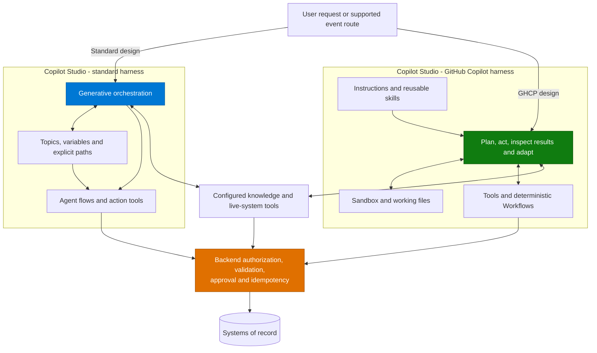
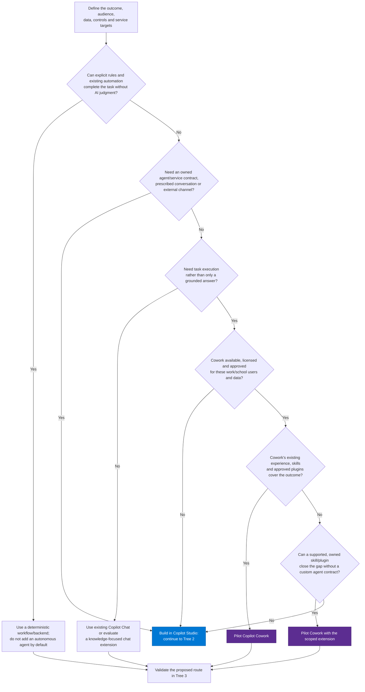
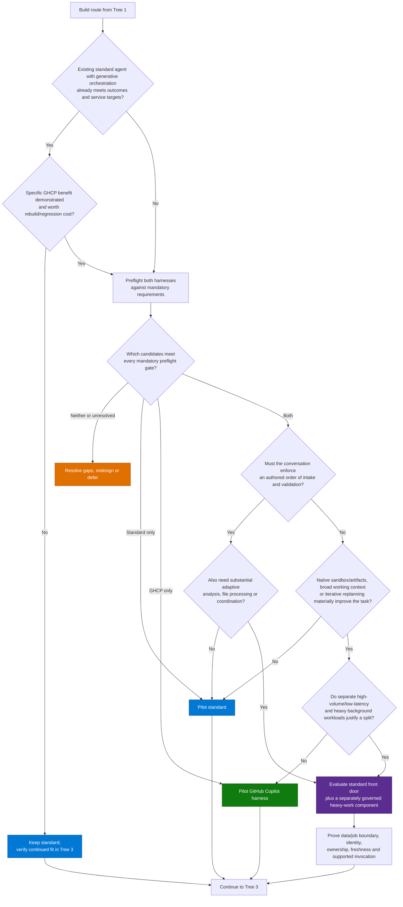
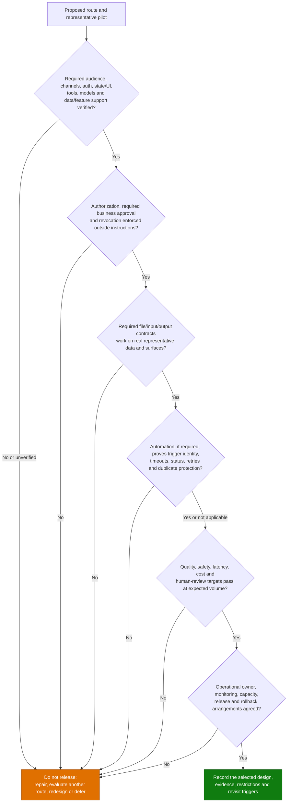

# Copilot Studio Harness Selection and Cowork Decision Pattern

> **Use Copilot Cowork when the existing Microsoft 365 work experience can complete the task.
> Build a Copilot Studio agent when you need to own the deployed agent and process contract.
> Within Studio, choose standard for bounded work and explicit conversational control, or
> GitHub Copilot for adaptive, reasoning-heavy coordination. Mandatory requirements come first.**

This pattern first decides **use an existing experience or build an agent**, then compares two
runtimes **inside Microsoft Copilot Studio**. Cowork is an experience choice, not a third Studio
harness. Here, **Cowork means Microsoft 365 Copilot Cowork for work or school accounts**, not
Anthropic Claude Cowork or the personal-account preview. Use the
[selection runbook](Copilot-Studio-Harness-Selection-Runbook.md) to turn the comparison into a
documented architecture decision. Check the
[upfront compatibility gaps](#first-check-ghcp-compatibility-gaps) before following the
[comprehensive decision tree](#comprehensive-decision-tree).

Throughout this pattern, the **standard-harness baseline uses generative orchestration**.
Topics, variables, and deterministic flows remain available to constrain the parts of the process
that need explicit control.

**Evidence reviewed: 19 October 2026.** Product support is based on the official sources linked
below; recommendations and example allocations are architecture guidance, not benchmark results.
Recheck the required features in the target environment before committing to a harness.

---

## First Check: GHCP Compatibility Gaps

The GitHub Copilot harness inside Copilot Studio is **not a feature-compatible upgrade** of the
standard harness. Check this list before comparing reasoning quality or task weight, especially
when rebuilding an existing agent.

**Status key:** **Unavailable** means the documentation explicitly states that a capability,
channel, or setting is unavailable. **Different** means the documented configuration or execution contract changes.
**Preview** means additional release/environment restrictions apply. **Unverified parity** means
the reviewed official sources do not establish an equivalent GHCP contract: it is not a claim that
the capability is impossible, but it must not be recorded as supported without evidence.

### Publishing Channels and Authentication

| Capability | Standard harness (generative) | GHCP gap or changed contract |
| --- | --- | --- |
| SharePoint embedding and native mobile/desktop apps | Established publishing routes, subject to each route's requirements | **Unavailable:** the GHCP channel table marks SharePoint and native-app Direct Line integration **No**. Microsoft Copilot, Teams, demo website, and iframe-based web app are listed **Yes**; they do not establish native-app or SharePoint parity |
| Messaging, contact center, email, and voice channels | Established integrations; check each channel rather than assuming universal support | **Unavailable:** GHCP lists Facebook, WhatsApp, Slack, Telegram, Genesys, LivePerson, Salesforce and ServiceNow contact-center channels, Twilio, Line, GroupMe, Direct Line Speech, and Email as **No**. Consuming one of these services as a tool is a different capability |
| Publishing the agent to MCP/A2A clients | **Unverified parity:** native MCP/A2A publishing is not documented for the standard harness. Consuming external MCP tools is supported with generative orchestration, but is the opposite direction | **Preview:** GHCP's inbound MCP-client and A2A-client channels require an early release cycle environment. This is not the same as letting an agent consume an MCP server |
| End-user sign-in and custom identity providers | **No authentication**, **Authenticate with Microsoft**, or **Authenticate manually**; manual configuration supports Entra ID variants and Generic OAuth 2, subject to channel/policy restrictions | **Different:** the documented GHCP dropdown lists **No authentication** and **Authenticate with Microsoft**, not **Authenticate manually**. Do not assume an existing custom OAuth sign-in, manual Entra configuration, or authentication-variable contract can be copied |
| Authentication tokens and tool connections | Authentication mode determines available `User.*` variables; manual authentication exposes token/login-state variables. Tools separately support user or agent-author authentication | **Unverified parity** for the standard topic token-variable contract. GHCP tools require their own authentication setup; an agent sign-in option does not prove the connector/MCP connection, SSO, token access, or effective downstream identity |

**Keep three security layers separate:** user-to-agent sign-in, web-channel credentials, and
agent-to-service connections. A Direct Line web-channel secret is not an end-user identity.
Likewise, authenticating the user does not prove that a tool runs as that user rather than its
connection owner. Test connection consent, denial, expiry/revocation, and the actual acting identity.

The GHCP settings article mentions SharePoint/Power Apps authentication surfaces and Direct Line
web security, while its channel table marks SharePoint and native apps unavailable. **Do not use a
security setting as evidence that a publishing channel exists.** Use the harness-specific channel
table and resolve any remaining documentation/environment mismatch before selection.

Sources:
[GHCP channel matrix](https://learn.microsoft.com/en-us/microsoft-copilot-studio/agents-experience/publication-channels-overview),
[GHCP MCP/A2A publishing scope and prerequisites](https://learn.microsoft.com/en-us/microsoft-copilot-studio/agents-experience/publication-channels-mcp-agent-to-agent),
[standard publishing](https://learn.microsoft.com/en-us/microsoft-copilot-studio/publication-fundamentals-publish-channels),
[standard MCP consumption](https://learn.microsoft.com/en-us/microsoft-copilot-studio/agent-extend-action-mcp),
[standard authentication options](https://learn.microsoft.com/en-us/microsoft-copilot-studio/configuration-end-user-authentication),
[GHCP settings and authentication options](https://learn.microsoft.com/en-us/microsoft-copilot-studio/agents-experience/settings-overview),
[tool authentication](https://learn.microsoft.com/en-us/microsoft-copilot-studio/configure-enduser-authentication),
and [GHCP tool setup](https://learn.microsoft.com/en-us/microsoft-copilot-studio/agents-experience/add-tools-custom-agent).

### Topics, Variable Scopes, and Adaptive Cards

| Capability | Standard harness (generative) | GHCP gap or changed contract |
| --- | --- | --- |
| Topics, nodes, and prescribed conversational branching | Topics can enforce ordered intake, validation, interruptions, and handoffs alongside generative orchestration | **Different:** GHCP authors instructions, skills, tools, and connected resources instead of the same topic-node canvas. Workflows can preserve deterministic process steps, but are not an automatic conversion of the conversation |
| Local/topic variables (`Topic.*`) | Typed values local to a topic, with explicit topic inputs/outputs and node bindings | **Different:** the standard topic-variable authoring contract is not the GHCP Build model. Remap required values to explicit tool/workflow inputs, outputs, and validation; do not assume existing `Topic.*` references resolve |
| Global variables (`Global.*`) | Shared across topics in one user's session; not tenant-wide or durable across all conversations | **Different:** GHCP working context and optional memory are not equivalent to the standard global-variable scope, initialization, or reset contract. Prove state lifetime and user/session isolation; keep durable business state in its owning system |
| System variables (`System.*`) | Defined conversation, activity, bot, and user context, such as `System.Conversation.Id` | **Unverified parity:** the standard variable reference explicitly applies to the standard harness; the reviewed GHCP authoring documentation does not establish the same full variable namespace. Verify each required context value and trusted identity source rather than copying expressions or accepting identity from a prompt |
| Power Platform environment variables | Read-only solution configuration; ordinary changed values require agent republication, while secret values are retrieved at runtime | **Unverified parity:** no equivalent direct GHCP agent binding is established by the reviewed sources. Prove the supported binding, deployment override, and refresh behavior in the consuming component. A Bash environment variable is not a Power Platform solution environment variable |
| Adaptive Card authoring and input collection | **Ask with Adaptive Card** nodes, JSON/Power Fx cards, typed output variables, validation, retries, and interruption behavior; supported schema/actions depend on the host | **Unverified parity:** the reviewed GHCP sources do not establish the same card-node designer, variable bindings, or submit/resume contract. Prove rendering, inputs, submit actions, validation, and continuation in the required published channel; generated card JSON or a connector posting a card is not proof of equivalent in-chat behavior |

This is **not** a claim that GHCP workflows or tools cannot have variables or structured state.
Topic variables, workflow-local values, conversation context, per-user memory, shell environment
variables, and Power Platform environment variables are different mechanisms. Map the required
behavior explicitly. Never replace an approval record with a remembered `Approved = true`, or put
secrets into instructions, skills, model-visible conversation context, or generated files.

Sources:
[standard variable scopes and environment-variable lifecycle](https://learn.microsoft.com/en-us/microsoft-copilot-studio/authoring-variables-about),
[standard global-variable lifecycle](https://learn.microsoft.com/en-us/microsoft-copilot-studio/authoring-variables-bot),
[standard Adaptive Card contract](https://learn.microsoft.com/en-us/microsoft-copilot-studio/authoring-ask-with-adaptive-card),
and [GHCP authoring components](https://learn.microsoft.com/en-us/microsoft-copilot-studio/agents-experience/overview).
The standard-only references establish the baseline, not GHCP support or a universal GHCP prohibition.

### Knowledge Sources and Language Models

| Capability | Standard harness (generative) | GHCP gap or changed contract |
| --- | --- | --- |
| Knowledge source types and configuration | Enterprise knowledge categories plus topic-level generative answers configuration | **Different configuration, not a blanket source-type gap:** Microsoft documents the same source categories for GHCP, including websites, files, SharePoint, OneDrive, and connector-based sources. Dataverse and other entries can depend on environment/licensing. Recheck the exact source, permissions, filters, refresh, citations, and any topic-specific retrieval control; the same category does not establish identical settings |
| General knowledge / ungrounded-response control | **Allow ungrounded responses** can block a turn that used neither a knowledge source nor a tool; turning it off does not guarantee that the model never incorporates general knowledge | **Unavailable setting:** GHCP explicitly has no general-knowledge on/off setting. Instructions and approved sources are not an equivalent enforcement switch. A strict grounding requirement needs a separately validated design, including source/citation checks and unsupported-question tests |
| Primary model catalog and reasoning options | Harness-specific model/region table, including reasoning options; separate model settings can apply to prompts and other AI components | **Different:** GHCP has its own model catalog, release tags, regional availability, and admin controls. At the review date, the standard table lists GPT-4.1, while GHCP lists GPT-6 Astra and Claude Opus 5; both list GPT-5.5 Chat. Reasoning is not exclusive to GHCP, and a model available to one harness or a called prompt is not automatically available as the other's primary model |

Check the selected model **and every called AI component**. Preview/experimental models are for
exploration and testing, not production. External-provider approval and preview-model approval are
separate controls; cross-region processing, early-release requirements, fallback, and retirement
behavior also need review. Do not substitute a CLI/SDK model list or assume arbitrary BYOM support.

Sources:
[standard knowledge behavior and grounding controls](https://learn.microsoft.com/en-us/microsoft-copilot-studio/knowledge-copilot-studio),
[GHCP knowledge differences](https://learn.microsoft.com/en-us/microsoft-copilot-studio/agents-experience/knowledge-add-existing-copilot),
[GHCP source types](https://learn.microsoft.com/en-us/microsoft-copilot-studio/agents-experience/knowledge-sources-overview),
[standard primary-model catalog](https://learn.microsoft.com/en-us/microsoft-copilot-studio/authoring-select-agent-model),
[GHCP model catalog](https://learn.microsoft.com/en-us/microsoft-copilot-studio/agents-experience/authoring-agent-model-availability),
and [GHCP model controls](https://learn.microsoft.com/en-us/microsoft-copilot-studio/agents-experience/authoring-select-agent-model).

### Other Nonportable Contracts and Limits

| Capability | Standard harness (generative) | GHCP gap or changed contract |
|---|---|---|
| Event-triggered work | Configured generative-agent event triggers, with documented author-credential behavior | **Different:** validate event/schedule -> Workflow -> Agent node -> published GHCP agent. An agent calling a Workflow tool is the opposite direction; an Outlook workflow is not an Email publishing channel |
| Session state versus persistent memory | Conversation variables and explicitly designed persistence | **Preview / different scope:** GHCP memory is per-user and unavailable in group chats and Teams channels. It is not a global/session-variable replacement, and turning it off does not delete stored memories |
| File ingress and deliverable return | Verify the selected standard channel/tool's limits and processing contract | **Different limits:** GHCP user attachments are limited to **16 MiB per file**; created files to **10 MB per file**. Created-file delivery documentation is marked **preview**. Verify the actual surface and feature status; larger reasoning context does not remove upload, delivery, or retention limits |
| Existing agent/components and migration | Keep a working standard agent and its validated behavior where appropriate | **Unavailable transfer:** agents cannot be transferred between harnesses. Rebuild required behavior and revalidate connections, state, cards, sources, models, channels, and lifecycle; do not treat migration as changing a setting |

Sources:
[standard event triggers](https://learn.microsoft.com/en-us/microsoft-copilot-studio/authoring-trigger-event),
[GHCP Workflow invocation](https://learn.microsoft.com/en-us/microsoft-copilot-studio/workflows-experience/agent-node-workflow),
[memory](https://learn.microsoft.com/en-us/microsoft-copilot-studio/agents-experience/memory-overview),
[attachments](https://learn.microsoft.com/en-us/microsoft-copilot-studio/agents-experience/attachments-overview),
[created files and preview status](https://learn.microsoft.com/en-us/microsoft-copilot-studio/agents-experience/created-files-overview),
and [cross-harness transfer limitation](https://learn.microsoft.com/en-us/microsoft-copilot-studio/agents-experience/overview).

**Decision rule:** a mandatory unavailable capability excludes that candidate. A changed contract
needs an accepted, demonstrated redesign; preview needs the required approval/environment; and
unverified parity remains a blocker until resolved. Neither a successful Preview chat nor general
availability of the harness proves compatibility. Apply these checks at **Q8** and again at **Q13**,
using the [runbook's compatibility matrix](Copilot-Studio-Harness-Selection-Runbook.md#step-2---apply-mandatory-compatibility-gates).

---

## Why This Pattern

| Signal | Decision this pattern helps make |
|---|---|
| Employees need research, Office artifacts, or recurring work in Microsoft 365 | Check whether Cowork already meets the need before building another agent |
| A new business agent could be built with either harness | Select the smallest runtime that meets the outcome, control, and service requirements |
| An existing standard agent is becoming difficult to maintain | Establish whether the problem is orchestration complexity, poor data, or a missing integration |
| A team assumes only GHCP can plan and use tools | Assess standard generative orchestration, autonomous triggers, and tool use before proposing migration |
| A team assumes the GitHub Copilot harness replaces every existing feature | Check channel and feature coverage before comparing reasoning capabilities |
| A solution combines high-volume chat and substantial background analysis | Consider separate workloads without forcing every request through the heavier runtime |

The output is a justified choice: **Cowork**, **standard**, **GitHub Copilot**, **a split design
with an explicit boundary**, or **defer/redesign because a mandatory requirement is not met**.
Simple answers and purely deterministic automation have explicit off-ramps; not every request
needs an agentic runtime.

---

## What Is Being Compared?

A **model** provides reasoning and generation. A **harness** manages the model's context, tool
calls, intermediate results, and progress through a task. Changing the harness is not simply
changing the model.

| Term | Meaning in this pattern |
|---|---|
| **Standard harness** | The established Copilot Studio runtime for agents and agent flows; evaluated here with generative orchestration using topics, variables, tools, knowledge, and other agents |
| **GitHub Copilot harness (GHCP)** | The Copilot Studio runtime for adaptive, reasoning-heavy work, using instructions, tools, knowledge, Markdown-based skills, a sandbox, and optional memory and connected agents |
| **Copilot Cowork** | An existing Microsoft 365 task-execution experience with built-in skills, custom skills, plugins, task controls, and automations. Compare it at the use-versus-build layer, not as a Studio harness |
| **Copilot chat harness** | A third Copilot Studio option for extending Microsoft Copilot Chat. A knowledge-focused off-ramp in the tree; not a synonym for Cowork or a fourth full comparison here |
| **GitHub Copilot CLI / SDK / coding agent** | Separate development products and hosting choices. Their APIs, subscriptions, tools, and deployment assumptions are not evidence of support inside Copilot Studio |

Microsoft states that the Studio GHCP harness is not the GitHub Copilot service and that agent
customer data is not sent to that service. Copilot Studio's existing privacy, security, compliance,
and residency commitments continue to apply. Still review the selected model, external tools,
connections, and any cross-region processing requirements.

Sources: [Harnesses overview](https://learn.microsoft.com/en-us/microsoft-copilot-studio/harnesses-overview),
[official selection guidance](https://learn.microsoft.com/en-us/microsoft-copilot-studio/guidance/choose-harness),
and [model controls](https://learn.microsoft.com/en-us/microsoft-copilot-studio/agents-experience/authoring-select-agent-model).

---

## Where Cowork Fits

Cowork and a GHCP Studio agent can both perform substantial multi-step work and create files.
**Task complexity alone does not decide between them.** First decide whether the product's existing
work experience meets the requirement or whether the organization needs to own a deployed agent,
its process contract, and its release lifecycle.

| Decision dimension | Copilot Cowork | A custom Copilot Studio agent |
|---|---|---|
| Starting point | Delegate work in the existing Microsoft 365 experience | Design and deploy a named agent for a defined audience and process |
| Typical work | Research, meeting preparation, communications, Office artifacts, calendar/file work | Domain-specific conversations, service workflows, system actions, or reusable business outcomes |
| Reuse and customization | Built-in skills, personal custom instructions, custom skills, and plugins; skills/plugins can be shared and plugins admin-deployed | Agent instructions/components, configured tools and sources, and managed agent releases |
| User experience | Cowork's task, file, approval, and automation surfaces | Chosen supported channels, authentication, conversation design, and integration contracts |
| Scheduled/event work | Scheduled prompts and supported email/Teams event-driven tasks | Standard event triggers or GHCP Workflows with verified invocation and operating behavior |
| Action control | Sensitive-action approvals, with session-scoped options to skip similar prompts; event tasks default to draft-and-approve | Authored process controls and backend policy, plus any required user/business approvals |
| Integration effort | Use approved plugins/connectors; custom integrations still need hosting, authentication, and ownership | Configure supported connectors/MCP/workflows/agents; custom integrations carry the same obligations |
| Operations and billing | Enable Cowork, assign the required Microsoft 365 Copilot license, and enable usage-based/Cowork billing; manage tasks and extensions | Own environment capacity, agent evaluation/publishing/monitoring, and harness-specific consumption |

Sharing a skill with a team is **not** by itself a reason to build a Studio agent. Conversely,
installing a plugin does not prove that Cowork meets a required channel, transaction contract,
non-bypassable approval policy, or service-level objective.

Cowork for work/school accounts is documented as **generally available**; the App skill remains a
**Frontier preview**. Scheduled and event-driven tasks do not make Cowork a substitute for a
durable enterprise job service. Verify invocation, run identity, limits, failure notification,
approval behavior, and reconciliation for the actual automation.

Cowork's action consent is also not automatically a business approval: a user's **Always allow**
choice cannot satisfy a required manager/Finance authorization. Enforce that policy in the backend
or an independently governed process, whichever experience calls it. Removing a Cowork plugin does
not interrupt active conversations already using it; revoke backend access where immediate
revocation is required.

Sources:
[Cowork overview](https://learn.microsoft.com/en-us/microsoft-365/copilot/cowork/),
[access and billing prerequisites](https://learn.microsoft.com/en-us/microsoft-365/copilot/cowork/get-started),
[actions and automations](https://learn.microsoft.com/en-us/microsoft-365/copilot/cowork/use-cowork),
[plugins](https://learn.microsoft.com/en-us/microsoft-365/copilot/cowork/cowork-plugins),
and [sharing/customization](https://learn.microsoft.com/en-us/microsoft-365/copilot/cowork/cowork-customize).

---

## Differences That Affect the Decision

| Dimension | Standard harness (generative) | GitHub Copilot harness | Decision implication |
|---|---|---|---|
| Authoring | Topics, nodes, variables, prompts, tools, and agent flows; explicit paths where needed | Build surface combining instructions, knowledge, tools, skills, model, and memory | Match the required control and the team's maintenance skills, not just initial authoring convenience |
| Orchestration | Generative selection of topics, knowledge, tools, and agents | Enhanced orchestration evaluates intermediate results and adjusts the plan | Both can plan and act; GHCP is a stronger candidate when the next step cannot be fully anticipated |
| Task weight | Shorter, bounded tasks with a stable working set and usually one primary result | Longer tasks, broader working context, iterative analysis, parallel work, and several outputs | There is no universal number of steps or minutes that decides the harness |
| Conversation control | Topic nodes support ordered questions, validation, and prescribed handoffs | Instructions and skills guide adaptive conversation; workflows provide explicit process steps | Prefer standard when the ordered conversation itself is the requirement; do not confuse instructions with enforced branching |
| Context and delegation | Makers manage context across topics, variables, tools, and agent boundaries | Larger working context and orchestration across files, results, and specialist work | Validate actual handoff payloads and identity; connected agents still have their own orchestration context |
| Files and computation | Use supported knowledge, tools, prompts, and external processing services as needed | Native file creation/editing and sandbox-based processing, including a Bash environment | GHCP is attractive for analyzing data and producing Office/PDF artifacts, not merely because a document is involved |
| Reusable procedures | Topics, prompts, flows, and other configured components | Markdown-based agentic skills can bundle instructions, scripts, and resources | A skill describes how to work; it does not provision a connector or grant permission |
| Memory | Conversation variables and explicitly designed persistence where needed | Optional per-user memory across interactions; currently preview | Enable only for a specific benefit, with privacy and lifecycle approval; never store authorization decisions as memory |
| Knowledge | Configured enterprise knowledge with source-specific behavior and permissions | Same knowledge-source categories, with different configuration behavior and no general-knowledge on/off setting | Test grounding, citations, and access separately; do not assume identical defaults or a knowledge-only guarantee |
| Tools and connectivity | Connectors, MCP, agent flows, and supported agent integrations | Connector actions, MCP tools, Workflows, and supported connected agents | Having a connector or MCP server is not by itself a reason to select GHCP |
| Autonomous work | Generative agents can react to configured event triggers | Workflows can start on events or schedules and call a published agent | Verify the exact inbound route; an agent calling a workflow is the opposite direction |
| Channels | Established web, Microsoft, messaging, app, and other channel integrations | A different, currently smaller channel set | A missing mandatory channel overrides a favorable reasoning comparison |
| Billing | Existing Copilot Studio licensing and feature/activity-based credit rates | Usage-based credits cover models, tools/knowledge/MCP, and the harness; AI-assisted building, testing, and evaluating also consume credits | Compare the complete lifecycle and cost per accepted outcome, not credits per chat message |
| Lifecycle | Existing standard agents remain supported | Separate agents; no transfer to or from the standard harness | Migration is a rebuild and revalidation, not a switch or automatic component conversion |

The table synthesizes
[Microsoft's harness comparison](https://learn.microsoft.com/en-us/microsoft-copilot-studio/guidance/choose-harness).
Important feature details are documented in
[standard generative orchestration](https://learn.microsoft.com/en-us/microsoft-copilot-studio/advanced-generative-actions),
[GHCP agent components](https://learn.microsoft.com/en-us/microsoft-copilot-studio/agents-experience/overview),
[skills](https://learn.microsoft.com/en-us/microsoft-copilot-studio/agents-experience/skills-overview),
[knowledge](https://learn.microsoft.com/en-us/microsoft-copilot-studio/agents-experience/knowledge-add-existing-copilot),
and [memory](https://learn.microsoft.com/en-us/microsoft-copilot-studio/agents-experience/memory-overview).
Markdown agentic skills are not the standard harness's Azure Bot Service skills.

### Availability Is a Gate, Not a Score

The GHCP harness is
[generally available](https://www.microsoft.com/en-us/copilot/blog/copilot-studio/new-and-improved-github-copilot-harness-agent-skills-and-richer-context/).
That does not make every model, channel, or optional feature generally available.

Use the [upfront compatibility checklist](#first-check-ghcp-compatibility-gaps) as a hard gate,
not a feature score. It separates explicit gaps from changed contracts, previews, and unverified
parity, including authentication, all four standard variable scopes, Adaptive Cards, knowledge,
models, channels, and file limits. Resolve mandatory gaps before a pilot comparison; a demo website
or a working test-pane response is not a production compatibility result.

---

## Studio Architecture Diagram

After choosing to build in Studio, these are alternative execution designs, not an instruction to
deploy two agents. Both retain business authorization and consequential action checks outside
model instructions. Cowork remains the separate existing-experience route described above.

Knowledge retrieval and live-system operations are distinct even when shown together here:
indexed articles do not provide live record access or write permission. Connections and backend
permissions must be configured for each design; the diagram does not imply shared credentials.
Deterministic workflows can enforce a sequence, but an AI step inside that sequence is still
probabilistic and its output must be validated.

### Event Routes Must Be Compared in the Correct Direction

| Intent | Standard harness route | GHCP route to validate |
|---|---|---|
| Start work because an external event occurred | A configured event trigger on a generative agent | Event-triggered Workflow -> Agent node -> published target agent -> downstream steps |
| Let an agent call a repeatable process | Agent -> configured agent-flow tool | Agent -> Workflow tool with the agent-call trigger and response |
| Receive ordinary conversation over a channel | Supported published channel | Supported GHCP channel; an Outlook-triggered Workflow is not a native Email channel |

The [standard event-trigger article](https://learn.microsoft.com/en-us/microsoft-copilot-studio/authoring-trigger-event)
explicitly applies to the standard harness and documents author-credential use.
[GHCP Workflows](https://learn.microsoft.com/en-us/microsoft-copilot-studio/workflows-experience/flows-overview)
and the [Workflows Agent node](https://learn.microsoft.com/en-us/microsoft-copilot-studio/workflows-experience/agent-node-workflow)
document the inbound GHCP automation pattern. Confirm the selected agent, published version,
output shape, and execution identity. Do not infer support from a similarly named connector,
a standard-harness SDK example, or a CLI API.

---

## Comprehensive Decision Tree

Read the three trees in order. **Tree 1 selects the experience; Tree 2 selects a Studio harness
only when building is warranted; Tree 3 validates every proposed outcome before release.**
Arrows recommend a candidate for evaluation, not unconditional product support. The question
guide below explains what qualifies as a Yes.

### Tree 1 - Use Cowork, Build an Agent, or Avoid an Unnecessary Build?

Cowork being unavailable does not prove Studio is permitted or cheaper. The build route still
needs all Studio gates, and it can end in defer/redesign. Q1 precedes the knowledge-only off-ramp
so even a single-answer agent takes the build route when it requires an owned channel or service
contract.

### Tree 2 - Which Studio Harness?

Preflight each harness against mandatory channel, identity, source/tool, model, data, file,
invocation, and release-status requirements. Evaluate workload preferences only for eligible
candidates; a missing mandatory feature cannot be outweighed by a better reasoning score.

The standard candidate uses generative orchestration throughout this comparison.
A few tools, MCP access, document inputs, or autonomous triggers do not alone establish a GHCP
requirement. GHCP also supports deterministic Workflows: an authored backend sequence does not
require standard when the conversation itself need not be a topic graph.

A split is a candidate architecture, not an automatic two-agent deployment. First test whether one
eligible harness with a narrow tool/workflow can meet the requirement. If not, define the smallest
boundary; prefer an explicit data/job contract to assuming cross-harness agent-call compatibility.
If the boundary cannot meet the requirements, redesign rather than declaring the split selected.

### Tree 3 - Is the Proposed Design Actually Releasable?

Apply this to Cowork, a Studio candidate, a split, or either off-ramp. For an existing deployment,
use current evidence rather than assuming that its earlier approval covers a changed requirement.

### How to Answer the Branch Questions

| Questions | Evidence for Yes | Do not mistake this for Yes |
|---|---|---|
| Q0: rules are sufficient | The existing deterministic process can deliver the result without runtime AI judgment/generation | A long list of steps alone; identify whether any actually need AI |
| Q1: owned agent/service contract | A custom channel/audience, prescribed conversation, formally owned integration/job contract, or release/operations requirement the existing experience cannot satisfy | A recurring task, several users, or a shared skill alone |
| Q2: task execution beyond answers | Named actions or artifacts to produce, not only finding/summarizing information in chat | Treating every grounded answer as an autonomous workflow |
| Q3: Cowork readiness | Work/school availability, license, enabled usage billing, approved data/model/providers, and access for the intended users | Consumer availability, the App-skill preview, or an assumed included entitlement |
| Q4-Q5: Cowork coverage / extension | The actual task completes using built-ins or a supported, scoped skill/plugin, with a named integration owner and tested identity | A generic connector listing, an unhosted MCP definition, or instructions claiming an unavailable action |
| Q6-Q7: keep or rebuild | Existing measured acceptance results plus a specific, demonstrated improvement that justifies migration | A new harness announcement or an assumption that standard cannot reason |
| Q8: compatibility | Dated official support plus target-environment evidence for the upfront checklist: channels, authentication, required variable/state and card contracts, knowledge controls, models, and other mandatory features | Roadmap promises, similarly named SDK APIs, or assuming a standard-only reference establishes GHCP parity |
| Q9-Q10: controlled conversation plus heavy work | Required intake/validation order, and separate proof of the analysis/data/artifact need | A mandatory backend approval alone; both harnesses can call a controlled process |
| Q11-Q12: adaptive workload / split | Representative work showing why sandbox processing, intermediate context, replanning, or separate service profiles matter | An arbitrary count of steps/files or the word "autonomous" in the requirement |
| Q13-Q16: safety and integration | Positive and negative identity tests, backend-enforced policy, validated artifacts, and reconciled failure/automation behavior | A successful chat answer, removable skill text, action consent in place of manager approval, or accepted work labeled complete |
| Q17-Q18: release viability | Measured accepted outcomes and lifecycle consumption, volume assumptions, named operators, and a workable rollback | An average quality score that hides prohibited actions or cost estimates that omit retries and evaluation |

For every decision, retain the branch answers, evidence, alternative rejected, and revisit
condition. The [runbook](Copilot-Studio-Harness-Selection-Runbook.md) supplies the corresponding
compatibility, pilot, measurement, and decision-record tables.

---

## Real-World Scenario Choices

These are illustrative decisions, not claims that a linked scenario has been deployed or compared
under identical conditions.

| Scenario | Starting choice | Why / what would change the decision |
|---|---|---|
| A seller delegates a meeting brief and QBR artifacts using Microsoft 365 and an approved CRM plugin | **Cowork** | Existing research, Office skills, and user-steered task controls may meet the outcome without a custom agent; validate the CRM integration, branding, and approvals |
| A team shares a reusable account-planning procedure | **Cowork with shared skills/plugins**, if sufficient | Reuse does not itself require a Studio deployment; custom service/channel contracts or stronger process control can change the choice |
| A user's recurring briefing or matching-email triage | **Cowork**, if its supported automations meet the controls | Schedules and events are not exclusive to Studio; verify approval, user identity, rate limits, and failure handling |
| Employee policy Q&A with a small set of routine actions | **Standard** for the bounded two-harness case | Grounding and predictable response matter more than artifact generation; separately consider the Copilot chat harness if extending Copilot Chat is the entire need |
| HR intake requiring ordered questions and fixed case routing | **Standard** | The prescribed conversation and handoff are the requirement; autonomous email alone does not require GHCP |
| Read-only CRM search and a short customer summary through MCP | **Standard or GHCP**, with standard as the proportionate baseline | MCP and tool chaining exist in both. GHCP becomes more compelling for deep cross-system analysis or multiple deliverables |
| Invoice extraction followed by fixed validation and approval | **Standard plus suitable processing tools**, or GHCP if native file handling materially helps | A document or approval does not mandate GHCP; measure extraction quality and integration effort |
| Invoice/PO reconciliation with variable discrepancies and a generated review workbook | **GHCP plus deterministic validation and approval** | Iterative investigation, computation, and artifacts justify the heavier runtime; the model does not authorize payment |
| An owned meeting-preparation agent with a defined audience, integration contract, and evaluated brief/presentation outputs | **GHCP** | The custom deployed-agent requirement distinguishes it from delegating the same artifacts to Cowork; broad context and adaptive coordination distinguish it from a bounded standard agent |
| High-volume service chat over data needing substantial periodic cleanup | **Both, if justified** | Standard serves responsive chat; a GHCP background process prepares approved data. Prefer a governed data boundary over an assumed cross-harness agent call |
| A working agent on a channel absent from GHCP | **Keep standard** | Continuity and feature coverage outweigh a reasoning upgrade until an approved alternative exists |
| An agent requires Generic OAuth 2 user sign-in and topic authentication-token variables | **Standard unless a supported GHCP alternative is proven** | GHCP's documented user-authentication choices do not establish the manual sign-in/token-variable contract; a tool's own OAuth connection is not a replacement for agent sign-in |
| An intake process depends on authored Adaptive Cards, typed outputs, and session variables | **Standard as the proven baseline** | GHCP needs evidence for the required rendering, submit/resume, validation, and state behavior; instructions or generated card JSON do not prove equivalence |

Repository walkthroughs for applying the decision:
[HR standard](../../01-scenarios/HR-Onboarding-Agent/1.Overview.md),
[HR GHCP](../../01-scenarios/HR-Onboarding-Agent-GHCP/1.Overview.md),
[invoice standard](../../01-scenarios/Autonomous-Invoice-Orchestration-Agent/1.Overview.md),
[invoice GHCP](../../01-scenarios/Autonomous-Invoice-Orchestration-Agent-GHCP/1.Overview.md),
and [CRM account planning with Cowork](../../01-scenarios/CRM-Account-Planning-Cowork-Agent/1.Overview.md).
Their scopes and delivered assets differ; they are implementation references, not an A/B benchmark.

---

## Cost, Governance, and Migration

### Compare the Whole Cost

Both Studio harnesses use Copilot Credits, but their meters differ.
[Standard licensing](https://learn.microsoft.com/en-us/microsoft-copilot-studio/billing-licensing)
retains feature/activity-based consumption.
[GHCP usage-based billing](https://learn.microsoft.com/en-us/microsoft-copilot-studio/agents-experience/billing-credit-overview)
includes model tokens, tools, knowledge/MCP, and harness use, including AI-assisted authoring,
Preview, and Evaluate. Check the current licensing guide rather than assuming that a Microsoft 365
Copilot entitlement, GitHub Copilot subscription, or an old rate table covers the proposed workload.

Compare **credits per accepted business outcome**, including failed attempts, retries, rework,
and review effort. Budget for development and evaluation separately from recurring production use;
include connector, storage, and external-service costs where applicable. Neither harness is always
cheaper or faster.

For Cowork, the [work-account prerequisites](https://learn.microsoft.com/en-us/microsoft-365/copilot/cowork/get-started)
require an assigned Microsoft 365 Copilot license **and** enabled usage-based/Cowork billing.
Include license costs, measured charged usage, extension hosting, and review effort. Record the
applicable unit/rate from the tenant's current billing evidence; do not assume that Cowork is free
with the license or reuse a Studio rate table. Compare monetary cost per accepted outcome when
consumption meters are not directly comparable.

### Keep the Same Business Controls

For every design, verify effective end-user versus connection-owner identity, negative access cases,
least-privilege tool actions, data policies, retention, audit evidence, and model/provider approval.
Treat retrieved content and files as data, not instructions. Disable an action by removing tool
exposure and enforcing backend policy, not merely by removing a skill.

Adaptive recovery must not blindly repeat a write after a timeout. Reconcile source state first,
preserve completed steps, and distinguish accepted, pending, completed, failed, and unknown outcomes.
Longer-running reasoning is not a durable job queue or an unlimited workflow duration.

### Migrate Only for a Demonstrated Benefit

Between the Studio harnesses, there is
[no cross-harness agent transfer](https://learn.microsoft.com/en-us/microsoft-copilot-studio/agents-experience/overview).
Inventory what each topic, local/global/system/environment variable, Adaptive Card, authentication
mode, source configuration, prompt/model, flow, and channel achieves, then rebuild only the required
behavior using the target components. Use the upfront compatibility checklist to record each gap
and accepted replacement. Rebind connections and retest identities, state lifetime, configuration
overrides, card interactions, approval boundaries, output contracts, and publishing. Keep the
original agent available for a controlled rollback, and prevent duplicate event processing during cutover.

Do not migrate to fix missing source permissions, stale knowledge, a poor tool contract, or a
backend that has no supported action API. Those problems remain in the new harness.

Moving a procedure from Cowork to Studio is likewise not agent conversion. Reuse a skill's
procedure only after checking its host-specific tools, identity, inputs, approvals, and output
contract. A shareable Markdown format does not make connections, sessions, automations, or policies
portable.

---

## When to Use / Avoid

| Use this pattern when... | Do not use it to... |
|---|---|
| Deciding whether Cowork already satisfies the business task | Label Cowork a third Copilot Studio harness or compare it with Claude Cowork |
| Choosing a runtime for a new Copilot Studio agent | Compare all agent products or select a standalone SDK host |
| Assessing a standard-to-GHCP rebuild | Justify migration merely because GHCP is newer |
| Separating interactive and heavy background work | Force a two-agent architecture onto a simple process |
| Explaining capability and operating-cost tradeoffs | Promise universal quality, latency, cost, or channel parity |

---

## Related Patterns and Reference Documentation

- [Selection runbook](Copilot-Studio-Harness-Selection-Runbook.md)
- [CRM Account Planning Cowork Agent](../../01-scenarios/CRM-Account-Planning-Cowork-Agent/1.Overview.md)
- [Declarative vs Custom Engine Agent](../Declarative-vs-Custom-engine-agent/Declarative-Agents-vs-Copilot-Studio-Custom-Engine-Agents.md) - a different decision axis from harness selection
- [Copilot Studio Migration & Modernisation](../Copilot-Studio-Migration-and-Modernisation/Copilot-Studio-Migration-and-Modernisation.md)
- [Agent Publishing & Channel Deployment](../Agent-Publishing-and-Channel-Deployment/Agent-Publishing-and-Channel-Deployment.md)
- [Copilot Credits & Cost Control](../Copilot-Credits-Cost-Control/Copilot-Credits-Cost-Control.md) - verify harness-specific meters before reusing rate tables
- [Human-in-the-Loop Review & Approval](../Human-in-the-Loop-Review-and-Approval/Human-in-the-Loop-Review-and-Approval.md)
- [MCP Server Integration](../MCP-Server-Integration/MCP-Server-Integration.md)
- [Microsoft: Compare Copilot Studio agent harnesses](https://learn.microsoft.com/en-us/microsoft-copilot-studio/guidance/choose-harness) - primary product comparison
- [Microsoft: Access standard agents and agent flows](https://learn.microsoft.com/en-us/microsoft-copilot-studio/agents-experience/switch-experiences) - authoring navigation, not agent conversion
- [Microsoft: Copilot Cowork overview](https://learn.microsoft.com/en-us/microsoft-365/copilot/cowork/) - work/school experience and feature status
- [Microsoft: Use Copilot Cowork](https://learn.microsoft.com/en-us/microsoft-365/copilot/cowork/use-cowork) - approval modes, skills, scheduling, and event tasks

This pattern supplies decision and delivery guidance, not an agent, connector, workflow, or live
tenant validation. Official documentation describes product support; environment-specific evidence
is still required for the architecture decision.
