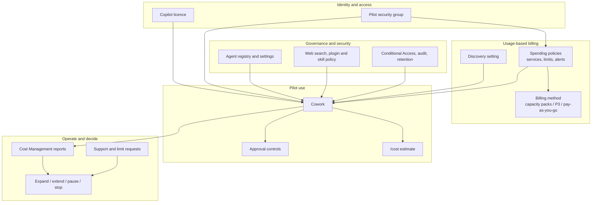

# Cowork Enablement

## Purpose

Enable, validate and operationalise Microsoft 365 Copilot Cowork through a repeatable,
governed process. This is a **platform enablement pattern**, not a business scenario or a
custom agent build. Apply it before, or alongside, a Cowork scenario's skill configuration
and integration work.

The pattern closes tenant readiness, identity, security, governance, billing, functional
validation and operational ownership. It ends with an evidence-backed **expand / extend /
pause / stop** decision. It does not replace the selected scenario's business-specific tests.

## When to Use / Avoid

| Use when | Avoid or separately scope when |
|---|---|
| Enabling Cowork for a bounded cohort or a new department | The runtime is Copilot Studio or Foundry rather than Cowork |
| Existing tenant enablement lacks evidence or accountable owners | Tenant-wide permission, content or labelling remediation is required |
| Introducing new skills, plugins, sources or consequential actions | Custom connector, MCP server or agent engineering is needed |
| Expanding an accepted pilot to additional users | Seeking a pricing quote, licence contract or guaranteed savings |

Use accepted tenant evidence where it remains current. Revalidate changed cohorts, sources,
permissions, policies and actions rather than repeating unrelated setup or assuming prior
approval covers the new scope. No ZIP, skill or plugin is supplied by this pattern.

## Control-Plane Architecture

Check licence, group membership, spending policy and funding, visibility, and runtime policy
separately. Discovery controls visibility; it is not a substitute for access restrictions.
Sharing a skill or enabling a spending policy does not grant permissions to underlying data.
Verify which agent-management controls apply to the actual tenant and package.

## Owners and Evidence

| Owner | Responsibility and evidence |
|---|---|
| Business sponsor / IT owner | Signed boundary, users, use cases, baseline and success criteria |
| M365 / Copilot administrator | Licence assignment, tenant availability, supported surfaces and pilot access |
| Security / compliance owner | Approved sources, exclusions, web/plugin/skill policy, approval, audit and retention posture |
| Billing owner / AI or licence administrator | Funding, policy scope, limits, alerts, reporting and limit-request route |
| Power Platform / Azure owner | Related billing plan, subscription, resource group, tags and budgets where applicable |
| Adoption lead / pilot users | Training, functional tests, usefulness and review-effort evidence |
| Support owner | Incidents, schedules, access changes, escalation and handover acceptance |

Keep customer configuration, source URLs, identity details and test evidence in the customer's
governed workspace. The [runbook evidence checklist](Cowork-Enablement-Runbook.md#evidence-artifacts)
identifies what to produce; configuration screenshots alone do not prove behaviour.

## How to Apply

1. **Bound the engagement:** name the sponsor, cohort, 2-3 use cases, sources, exclusions,
   funding and support owners. Stop if audience, outcome or billing ownership is unknown.
2. **Prepare the tenant:** verify licensing, Cowork availability, app/network readiness,
   permissions and security/governance posture. Stop on unaccepted controls.
3. **Configure access and policies:** restrict the cohort, approve trusted skills/plugins,
   and record discovery and consequential-action decisions.
4. **Close billing before substantive use:** activate approved funding and scoped policies;
   verify limits, alerts, effective membership and official reporting before widening discovery.
5. **Validate the platform and the scenario:** run the shared CWK tests plus business-specific
   tests for the selected scenario. Review numerical accuracy, privacy, approval and output access.
6. **Hand over and decide:** assign run-state owners, compare cost and preparation-plus-review
   effort to baseline, and record expansion or remediation.

Follow the [24-step implementation runbook](Cowork-Enablement-Runbook.md), including
[functional tests and safety/cost probes](Cowork-Enablement-Runbook.md#functional-tests-and-prompts).

## Boundaries That Must Hold

- Use current tenant licensing, role and availability guidance; no universal UI or fixed
  implementation duration is implied.
- Review in-scope source permissions before retrieval. File generation and redistribution
  require independent audience, classification, retention and destination checks.
- Prove runtime approval per approved action type. Skill instructions alone cannot enforce
  approval; if a mandatory gate cannot be demonstrated, keep the action manual or disabled.
- Record policy and per-user limits, funding, alerts and request owners. `/cost` is approximate,
  not an invoice or chargeback ledger. Do not import Copilot Studio rates into Cowork.
- Scheduled preparation needs an approved owner, source binding, period and stop control.
  Creating a schedule does not approve sending future outputs.
- Browser automation must respect sign-in, bot controls and site terms. Surface blocked tasks
  explicitly and use an agreed manual workflow or remove the unsupported use case.
- Expansion requires all critical gates, accepted support and sponsor approval, not merely
  a useful demonstration.

## Related Patterns

| Pattern | Responsibility |
|---|---|
| [Cowork Spending Policies and Cost Governance](../Cowork-Spending-Policies-and-Cost-Governance/Cowork-Spending-Policies-and-Cost-Governance.md) | Detailed funding, policy precedence, limits, alerts and reconciliation |
| [Pilot-to-Scale Validation Gates](../Pilot-to-Scale-Validation-Gates/Pilot-to-Scale-Validation-Gates.md) | Reusable evidence and decision gates for expansion |
| [Cowork Skill Delivery and Scheduled Reviews](../Cowork-Skill-Delivery-and-Scheduled-Reviews/Cowork-Skill-Delivery-and-Scheduled-Reviews.md) | Trusted package, routing, companion references, updates and schedule lifecycle |
| [Agent Governance and Rollout Control Plane](../Agent-Governance-and-Rollout-Control-Plane/Agent-Governance-and-Rollout-Control-Plane.md) | Applicable registry, sharing and user-access controls |
| [Human-in-the-Loop Review and Approval](../Human-in-the-Loop-Review-and-Approval/Human-in-the-Loop-Review-and-Approval.md) | Evidence preview, exact-action approval and rejection |
| [Copilot Credits and Cost Control](../Copilot-Credits-Cost-Control/Copilot-Credits-Cost-Control.md) | Cost discipline; its rate/enforcement tables apply to Copilot Studio, not Cowork |

## Scenario Applications

- The twelve [persona-based Cowork scenarios](../../01-scenarios/README.md#persona-based-cowork-scenarios)
  reuse these platform gates. Their archives do not provision source permissions, connectors,
  billing or schedules; each scenario adds its own source, domain, approval and output tests.
  Qualify coexistence with [Persona Skill Routing and Scope Isolation](../Persona-Skill-Routing-and-Scope-Isolation/Persona-Skill-Routing-and-Scope-Isolation.md).
- [Chief of Staff](../../01-scenarios/Chief-of-Staff-Cowork-Agent/1.Overview.md): qualify leader
  and delegate access, people-safety controls, draft review and the weekly schedule before
  accepting the five-skill workflow.
- [Insights Analyst](../../01-scenarios/Insights-Analyst-Cowork-Agent/1.Overview.md):
  close platform and cost gates, then separately prove actual data queries, KPI fidelity,
  RLS and copied-artifact access for each accepted function.
- [CRM Account Planning](../../01-scenarios/CRM-Account-Planning-Cowork-Agent/1.Overview.md):
  prepare the Cowork tenant and seller cohort; MCP authentication, backend authorization,
  CRM writes and template fidelity remain scenario-specific engineering and acceptance.

## Source Basis and References

Adapted from the user-provided *Cowork Enablement* Markdown delivery runbook.
Billing and `/cost` guidance was reviewed against public Microsoft documentation on
October 13, 2026. This pattern reclassification does not imply a new product verification or
live-tenant validation. See the [source interpretation notes](Cowork-Enablement-Runbook.md#source-basis-and-interpretation)
for source/documentation differences and tenant checks.

- [Cowork overview](https://learn.microsoft.com/en-us/microsoft-365/copilot/cowork/)
- [Get started with Cowork](https://learn.microsoft.com/en-us/microsoft-365/copilot/cowork/get-started)
- [Use Cowork](https://learn.microsoft.com/en-us/microsoft-365/copilot/cowork/use-cowork)
- [Customize Cowork](https://learn.microsoft.com/en-us/microsoft-365/copilot/cowork/cowork-customize)
- [Usage-based billing and Cost Management](https://learn.microsoft.com/en-us/microsoft-365/copilot/usage-based-billing-overview-copilot-credits)
- [Managing AI experiences enabled by usage-based billing](https://learn.microsoft.com/en-us/microsoft-365/copilot/usage-based-billing-manage-copilot-credits)
- [Check credit usage with `/cost`](https://learn.microsoft.com/en-us/microsoft-365/copilot/usage-based-billing-copilot-credits-cost)
