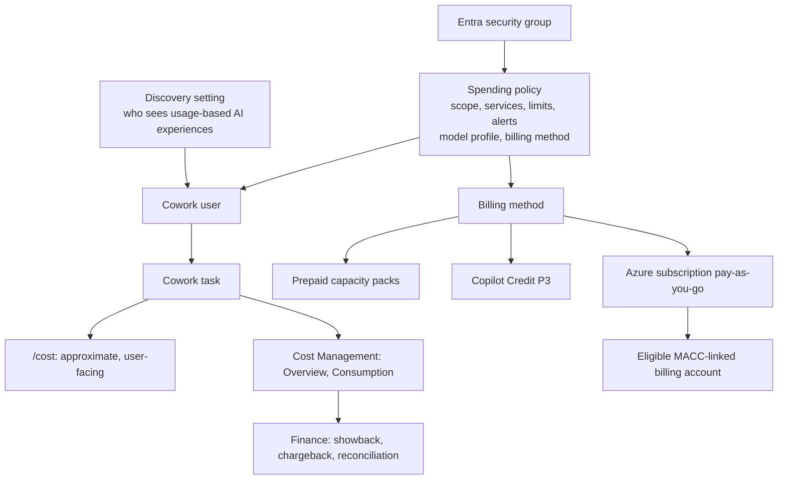

# Cowork Spending Policies and Cost Governance

> **A licensed user with no spending policy is a support ticket, not a pilot.** Cowork needs
> a Copilot licence *and* governed Copilot Credit consumption. Decide who may spend, how
> much, and who pays before anyone sees the Cowork button.

---

## Why This Pattern

| Signal | Evidence |
|---|---|
| **Industries** | All. Budget predictability is universal; regulated and cost-conscious sectors raise it first |
| **Where it appears** | Every Cowork pilot and every expansion beyond one cohort |
| **Typical trigger** | "We cannot turn it on until we can cap it, attribute it, and see it" |
| **Symptom in the field** | Users hit a limit with no request route; one user drains a shared pool; finance cannot attribute spend; Cowork visible before budget owners are ready |

The existing [Copilot Credits and Cost Control](../Copilot-Credits-Cost-Control/Copilot-Credits-Cost-Control.md)
pattern covers **Copilot Studio** rates and enforcement. Cowork is governed by a different
control plane: spending policies in **Copilot > Cost Management** in the Microsoft 365 admin
center. Do not carry Studio rates, thresholds or enforcement assumptions across.

---

## The Control Model

Three separate questions are often merged and must be answered independently:

| Question | Control | Common mistake |
|---|---|---|
| **May this person use Cowork?** | Licence, group, policy scope, discovery | Assuming a licence is enough |
| **How much may they consume?** | Policy limit and per-user limit | Setting only a shared pool |
| **Who pays?** | Billing method and subscription | Leaving the default without an owner |

---

## Design Rules That Hold Up

### 1. Close billing before discovery

Keep the discovery setting restricted until policies, limits, alerts and funding exist. Choose
deliberately: hidden until ready, pilot-only communication, or broad visibility. Visibility
ahead of ownership creates demand nobody has budgeted.

### 2. Scope policies by security group

Add people to a security group and target the group. It makes membership auditable and
lets a department, executive office or automation-heavy cohort have its own limit and its own
alert route.

### 3. Always set a per-user limit on a shared policy

A pool with no per-user limit lets one user consume the cohort's budget. Where no
per-user limit is set, the policy limit is used in precedence comparisons.

### 4. Know the precedence rules before overlapping

When a user is in several policies for the same service, the system picks one:

1. highest per-user limit;
2. if tied, largest overall policy limit;
3. if still tied, most recently created policy.

The chosen policy applies in full; settings from other policies are not combined. A user who
reaches their limit can request more credits but is **not** re-evaluated against another policy.
Prefer designing for no overlap; use overlap only when the outcome is intended and tested.

### 5. Consumption follows the user, not the group

Moving a user to another group or policy mid-period does not reset consumption. Credits
already used count against the new policy's limit. Plan departmental moves and chargeback
with that in mind.

### 6. Decide *Auto-apply new services* explicitly

It is on by default: newly supported Microsoft Copilot services and agents are added to the
policy as they appear. That may be right for a tenant-wide policy and wrong for a bounded
pilot or a regulated department. Record the decision per policy and re-review it when
Microsoft adds services.

### 7. Treat alerts as notifications, not brakes

An alert tells someone; it does not stop consumption. Pair thresholds with a named owner, an
investigation path and the limit-increase process. Where a hard cap matters, rely on the
limits, and verify the observed behaviour in the tenant.

### 8. `/cost` is a user signal, not a billing record

`/cost` shows approximate credits for the current task and month and what remains. It covers
the current cycle only, cannot estimate a task before it runs, and is not for invoice,
chargeback or budget reconciliation. Reconcile from Cost Management and the billing
portals.

### 9. Estimate by intensity, then measure

Cowork has no fixed public task-to-credit table. Cost varies with context retrieval, model
choice, tool actions, orchestration, document generation, deep research, scheduled prompts and
event-driven tasks. Estimate with a worksheet and the Microsoft Copilot Credit Estimator,
then replace the estimate with measured consumption after the first review.

### 10. Consider model profiles for bounded scope

For Cowork, an optional model profile restricts which models a policy may use. It requires at
least two models and a decision about whether Microsoft may substitute a comparable model
during an interruption. Use it where model choice is a cost or compliance control.

---

## Reporting and Reconciliation

| View | Use |
|---|---|
| Cost Management **Overview** | Credits used, prepaid and pay-as-you-go use, active users, users and policies nearing limits |
| Cost Management **Consumption** | Analysis by policy, user, group, agent and service; policy view and user view |
| Credit requests | Requests for access or higher limits, with configurable routing |
| Power Platform and Azure Cost Management | Related plan, subscription and budget views where the method flows there |

Reporting starts once policies exist; there is no retroactive data. *Active users* means users
who generated usage in the period, not everyone eligible. Define in advance how finance
turns this into showback or chargeback, and who owns monthly reconciliation.

---

## Real-World Scenarios

### Scenario A - Cowork visible before budget owners were ready
Discovery was open at launch. Users started tasks and requests arrived with no policy owner.
**Response:** restrict discovery, create the pilot policy and alert route, then open it to
the pilot group.

### Scenario B - One user consumed the shared pool
A group policy had a pool limit only. A single heavy user of deep research and document
generation exhausted it. **Response:** per-user limits, weekly user-level review, and a
documented limit-increase request path.

### Scenario C - Surprise policy for a moved user
A user in two groups landed on a policy nobody intended. **Response:** audit membership,
remove overlap, and record the precedence rules in the policy decision log.

### Scenario D - Departmental chargeback
Finance required spend by cost centre. **Response:** one security group and one targeted policy
per department, tags on the funding subscription, and a monthly reconciliation owner.

### Scenario E - Future service appeared in a pilot policy
A new supported service was added automatically to a policy built for a pilot.
**Response:** review *Auto-apply new services* per policy and add the setting to the
quarterly policy review.

These are illustrative situations to design against, not reported customer outcomes.

---

## When to Use / Avoid

| Use this pattern when | Do not use it when |
|---|---|
| Enabling Cowork or another service managed by usage-based billing | The workload is a Copilot Studio agent (use [Copilot Credits and Cost Control](../Copilot-Credits-Cost-Control/Copilot-Credits-Cost-Control.md)) |
| Moving from a pilot cohort to a department or tenant | You need a price quote or contract terms |
| Finance requires attribution, caps or showback | The question is who may create or share agents (use [governance](../Agent-Governance-and-Rollout-Control-Plane/Agent-Governance-and-Rollout-Control-Plane.md)) |

---

## Metrics Worth Tracking

| Metric | Why |
|---|---|
| Credits consumed per active user, by policy | Compares with the estimate; reveals heavy users |
| Share of consumption from high-intensity tasks | Targets training and limits |
| Users at or near their limit | Predicts requests and blocked work |
| Limit-increase requests and time to decision | Tests the process |
| Variance of actuals to the forecast | Triggers investigation |
| Active versus enabled users | Separates adoption from entitlement |

---

## Related Patterns and Scenarios

The twelve [persona-based Cowork scenarios](../../01-scenarios/README.md#persona-based-cowork-scenarios)
apply these controls to the approved cohort and its actual execution identity. Their package
billing/intensity labels are indicative planning metadata, not official rates. Validate tenant
entitlement and metering rather than inferring a universal billing rule from file creation.
Include preparation plus review, recurring/event volume and official reporting in acceptance.
Multi-persona installation does not create a separate spending identity for each persona.

- Runbook: [Cowork-Spending-Policies-and-Cost-Governance-Runbook.md](Cowork-Spending-Policies-and-Cost-Governance-Runbook.md)
- [Copilot Credits and Cost Control](../Copilot-Credits-Cost-Control/Copilot-Credits-Cost-Control.md) - the Copilot Studio counterpart
- [Pilot-to-Scale Validation Gates](../Pilot-to-Scale-Validation-Gates/Pilot-to-Scale-Validation-Gates.md) - the decision these controls feed
- [Agent Governance and Rollout Control Plane](../Agent-Governance-and-Rollout-Control-Plane/Agent-Governance-and-Rollout-Control-Plane.md)
- [Cowork Skill Delivery and Scheduled Reviews](../Cowork-Skill-Delivery-and-Scheduled-Reviews/Cowork-Skill-Delivery-and-Scheduled-Reviews.md) - scheduled prompts raise consumption
- [Cowork Enablement](../Cowork-Enablement/Cowork-Enablement.md) - shared tenant readiness and operational acceptance
- Scenario: [Chief of Staff](../../01-scenarios/Chief-of-Staff-Cowork-Agent/1.Overview.md) - leader cohort, weekly preparation and cost review
- Scenario: [Insights Analyst](../../01-scenarios/Insights-Analyst-Cowork-Agent/1.Overview.md) - recurring review intensity and function/cohort attribution
- Scenario: [CRM Account Planning](../../01-scenarios/CRM-Account-Planning-Cowork-Agent/1.Overview.md) - seller cohort, artifact-generation costs and separately funded MCP hosting

---

## Reference Documentation

- [Usage-based billing and Cost Management for Copilot Credits](https://learn.microsoft.com/en-us/microsoft-365/copilot/usage-based-billing-overview-copilot-credits)
- [Managing AI experiences enabled by usage-based billing](https://learn.microsoft.com/en-us/microsoft-365/copilot/usage-based-billing-manage-copilot-credits)
- [Check credit usage for Cowork tasks with `/cost`](https://learn.microsoft.com/en-us/microsoft-365/copilot/usage-based-billing-copilot-credits-cost)
- [Discovery setting for AI experiences](https://learn.microsoft.com/en-us/microsoft-365/copilot/discovery-setting-ai-experiences)
- [Copilot Credit P3](https://learn.microsoft.com/en-us/azure/cost-management-billing/reservations/copilot-credit-p3)
- [Pay-as-you-go plan overview](https://learn.microsoft.com/en-us/power-platform/admin/pay-as-you-go-overview)

Product behaviour reviewed October 13, 2026. Verify roles, portal paths and settings in the
target tenant before relying on them.
