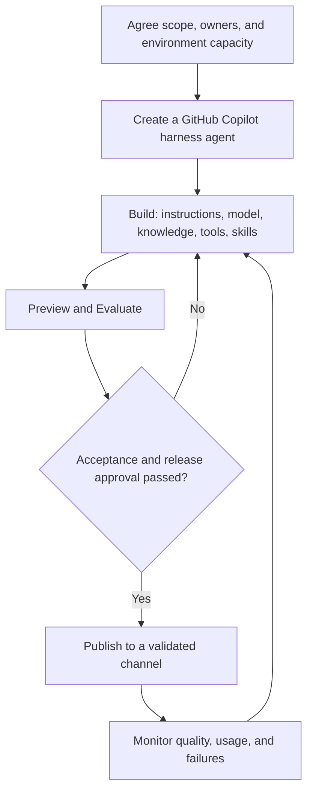

# GitHub Copilot Harness Execution in Copilot Studio - Runbook

**Official product guidance checked:** 2026-10-11.

## Purpose

Implement the execution pattern for one bounded task before expanding its scope.

This runbook specifies required behavior. It does not provide connector-specific configuration, a deployable agent package, or completed acceptance evidence.

## Prerequisites

| Owner | Required preparation |
|---|---|
| Business owner | Defines the outcome, scope, approved sources, reviewers, and success thresholds. |
| Platform administrator | Confirms harness availability, entitlements, creation permissions, channels, identities, connectors, Copilot Credit capacity, and limits. |
| Security reviewer | Approves access, data handling, retention, and action boundaries. |
| Builder | Prepares an isolated environment and representative authorized test data. |
| Operator | Establishes monitoring, escalation ownership, and stop procedures. |

Resolve unsupported capabilities before implementation. Do not assume that a described skill format or recovery mechanism is natively supported in every environment.

Before AI-assisted authoring or testing, approve the environment's capacity, tenant-pool draw, pay-as-you-go setting, and cost owner. GitHub Copilot harness agent usage isn't included with a user's Microsoft 365 Copilot license. AI-assisted creation, **Preview**, **Evaluate**, and runtime can consume credits.

For a prepaid-only boundary, allocate credits, disable **Draw from the available capacity in my tenant**, and don't link a pay-as-you-go billing plan. Assess other workloads in that environment before changing shared capacity. Azure budgets and alerts alone do not stop usage.

### Record the deployment path

Complete this record for the target environment before implementation; the reference design doesn't select a tenant, model, or channel for you.

| Decision | Required record and supported path |
|---|---|
| Invocation | Choose interactive use or a [Copilot Studio Workflow Agent node](https://learn.microsoft.com/en-us/microsoft-copilot-studio/workflows-experience/agent-node-workflow). The [Power Automate Microsoft Copilot Studio connector](https://learn.microsoft.com/en-us/power-automate/call-copilot-studio-agent) doesn't support calling GitHub Copilot harness agents. |
| Publishing channel | Record the selected channel and validate the [current channel support table](https://learn.microsoft.com/en-us/microsoft-copilot-studio/agents-experience/publication-channels-overview). Microsoft Teams, Microsoft Copilot, Demo website, and Web app are available; SharePoint, Native app, and Email aren't currently available channels for this harness. |
| Model and region | Record the model, environment region, permitted data movement, and applicable provider controls. Follow [model selection and administrator requirements](https://learn.microsoft.com/en-us/microsoft-copilot-studio/agents-experience/authoring-select-agent-model); don't use preview or experimental models for production. |
| Feature status | Record each selected feature's availability, preview terms, and environment requirements, including [Hooks](https://learn.microsoft.com/en-us/microsoft-copilot-studio/agents-experience/hooks-overview), [created files](https://learn.microsoft.com/en-us/microsoft-copilot-studio/agents-experience/created-files-overview), and [Agent Evaluate](https://learn.microsoft.com/en-us/microsoft-copilot-studio/agents-experience/analytics-agent-evaluation-intro). |
| Identity and human review | Record every tool's execution credentials, whether a live user is required, and the native Workflow or separate system responsible for mandatory review. |

## Authoring and Release Lifecycle

Original visual based on the public [agent lifecycle](https://learn.microsoft.com/en-us/microsoft-copilot-studio/agents-experience/overview#agent-lifecycle). Release approval and capacity gates are controls added by this runbook.

## Four Readiness Tracks

Keep these tracks active throughout the implementation steps, rather than treating deployment as proof of value.

| Track | Accountable owner | Evidence required |
|---|---|---|
| Business value | Business sponsor and KPI owner | Existing-process baseline, one primary business KPI, agreed target, and comparable pilot results. |
| Adoption | Process owner | Named users/reviewers, training, champions, and instructions for partial results and escalation. |
| Technical | Builder and platform owner | Supported channels, authorized tools, versioned configuration, acceptance cases, and recovery/stop procedures. |
| Cost and billing | Cost owner and administrator | Environment funding, agent limits, alert ownership, observed credit use, and a reviewed run-rate forecast. |

These are implementation readiness tracks, not additional product components.

## Step 1 - Establish the Task Contract

Specify:

- Required inputs and scope.
- Authoritative sources.
- Output fields and evidence requirements.
- Complete, partial, and blocked states.
- Prohibited actions.
- Human-review conditions.
- Maximum execution and retry limits.

Version instructions, skills, tool contracts, policies, and configuration together.

**Exit criteria:** Owners agree on the task and action boundaries.

## Step 2 - Establish Authorization

Give the agent read-only tools by default.

Enforce caller and service-identity permissions in the backend. If a shared service identity is required, implement requester-level authorization rather than relying on the agent to filter data.

Keep consequential write credentials outside the agent's tool set.

### Record execution identities and exposed actions

Signing in to the agent doesn't establish which identity a connected tool uses. With [maker-provided credentials](https://learn.microsoft.com/en-us/microsoft-copilot-studio/configure-no-maker-authentication), the connection owner's permissions can apply instead of the requester's.

For every connector action, MCP tool, and workflow connection, record the connection owner or service principal, authentication mode, backend permissions, requester-level checks, permitted sources/destinations, and interactive or background execution requirements.

Use [Build > Tools management](https://learn.microsoft.com/en-us/microsoft-copilot-studio/agents-experience/tools-manage) to remove unneeded connector actions and turn off individual MCP tools. Recheck the exposed surface after a server or connector changes. Disabling an agent association doesn't revoke the underlying connection's backend permissions.

Administrators can restrict **Control maker credential options** to end-user credentials, but the [credential policy](https://learn.microsoft.com/en-us/microsoft-copilot-studio/configure-no-maker-authentication) affects the environment or environment group, not just this agent. It requires live user authentication and can prevent scheduled or background runs. Review that impact before changing shared settings; never substitute broader credentials to make a denied request succeed.

Test with both an authorized user and a lower-privilege user, using the identities recorded for the actual invocation path.

**Exit criteria:** Out-of-scope access remains denied regardless of prompt wording or replanning.

## Step 3 - Implement Tools and Skills

Create the agent from the Copilot Studio home page in the approved environment. Choose the GitHub Copilot harness at creation; an existing standard harness agent can't be transferred to it.

In **Build**:

1. Configure **Instructions** and select the **Model**.
2. Add approved **Knowledge** sources and validate their use and citations. This harness has no general-knowledge on/off setting.
3. Add authorized **Tools** with accurate names and descriptions. For MCP, review every exposed tool and keep the attached server set small.
4. Add **Skills** by [uploading a Markdown skill file or a ZIP containing `SKILL.md`](https://learn.microsoft.com/en-us/microsoft-copilot-studio/agents-experience/skills-add-existing), with YAML front matter containing `name` and `description`, followed by Markdown instructions. **Create from Blank** and **Generate with AI** are also available authoring methods.

The scenario and pattern Markdown documents are reference documentation, not an upload-ready skill package. Create and validate the skill separately.

Once the agent exists, go to **Power Platform admin center > Licensing > Copilot Studio > Manage Agents > Set limit**. Set its monthly limit and notification threshold, and enable **Stop usage** when reaching the limit must stop usage. An alert-only limit doesn't stop consumption.

For each tool, define:

- Validated inputs.
- Output schema.
- Source and version metadata.
- Timeouts.
- Error categories.
- Permitted retry behavior.

Distinguish transient failures from denials, invalid inputs, and stale data.

For each skill, define entry conditions, ordered steps, output shape, edge cases, and escalation conditions.

Use application validation or equivalent controls to enforce output contracts. Procedural text alone is insufficient.

Knowledge search results don't establish full-document coverage. Where the task requires exhaustive review, implement authorized full-content retrieval/extraction and report missing sections or attachments.

**Exit criteria:** Tool and skill behavior is explicit and reproducible.

## Step 4 - Configure Bounded Execution

Implement clarification, planning, evidence selection, tool execution, verification, and safe replanning.

Verify that cited evidence supports the output.

Enforce call, time, and retry limits through supported configuration or an implemented controller/tool layer. At a limit, return an explicit partial or blocked result.

Agent monthly credit limits and environment capacity controls don't replace these per-run limits.

Never use an alternative tool to circumvent authorization.

### Native Hooks and independent enforcement

[Hooks (preview)](https://learn.microsoft.com/en-us/microsoft-copilot-studio/agents-experience/hooks-overview) run a published workflow at an agent lifecycle event. Configure them from the agent's top-menu **... > Hooks > Create**, select the event and applicable tools, and bind a workflow whose inputs and outputs match that event. Publish the workflow, save the agent, and publish the agent changes.

The [supported hook event contracts](https://learn.microsoft.com/en-us/microsoft-copilot-studio/agents-experience/hooks-overview#supported-hook-events) differ:

| Event | Supported response relevant to this pattern | Boundary |
|---|---|---|
| Pre tool use | `permissionDecision: deny` and `permissionDecisionReason` can block a tool call. | This is the event that can prevent the tool action before it runs. |
| Error | `errorHandling` accepts `retry`, `skip`, or `abort`; `retryCount` applies to `retry`, and `userNotification` can explain the error. | Applies to errors outside a tool call; the `recoverable` input is advisory, not permission to retry. |
| After tool failure | `additionalContext` supplies guidance alongside the tool error. | Doesn't expose the Error event's `errorHandling` or `retryCount` response fields. |

If a Hook workflow fails, times out, or returns an unreadable response, the [agent continues as though the Hook returned nothing](https://learn.microsoft.com/en-us/microsoft-copilot-studio/agents-experience/hooks-overview#things-to-know). Empty outputs also leave default behavior in place. A Hook is therefore not the sole enforcement boundary for authorization, mandatory review, retry limits, or consequential actions.

Keep critical access checks, durable call/retry counters, time limits, and write gates in supported runtime controls or an implemented backend/controller that rejects invalid or exhausted requests. Validate Hook inputs and any missing identity metadata; don't infer authority from a display name. If Hooks aren't available or approved in the target environment, retain independent enforcement rather than making the policy optional.

An exact per-run credit ceiling requires supported consumption data and an enforcement mechanism. If those aren't available, document the limitation and use measured call/time/retry bounds; don't claim that a Hook or monthly credit limit provides an exact per-run cost cap.

**Exit criteria:** The task terminates predictably under success, denial, and failure conditions.

## Step 5 - Implement Human and Workflow Handoff

Present the exact versioned artifact to an authorized reviewer.

### Choose the human-review implementation

The review boundary is outside the agent's inference, not necessarily outside Copilot Studio. Choose a native Workflow or a separate approved review system and record the path in the deployment record.

For a native Workflow, use [Human review > Request for information](https://learn.microsoft.com/en-us/microsoft-copilot-studio/workflows-experience/flows-request-for-information). Configure **Title**, **Message**, **Assigned to**, and the required decision inputs; save, publish, and test the workflow. It pauses at the request and resumes when a reviewer submits a response.

[Current RFI limits](https://learn.microsoft.com/en-us/microsoft-copilot-studio/workflows-experience/flows-request-for-information#add-request-information-in-your-workflow) are Outlook-only delivery, recipients in the same tenant, and use of the first response only. Later responses aren't processed. Assign one authorized reviewer for a single-reviewer gate. If policy requires multiple approvals or unanimous consent, implement explicit approval aggregation or use an approved system that supports that policy; one multi-recipient RFI isn't an all-reviewers approval.

A returned Yes/No or text value is human input, not proof of authority, artifact integrity, or an authorized business action. Validate the actual respondent through trusted workflow/review-system identity, not a user-editable Email input. The Agent node's optional [Request human assistance when unsure](https://learn.microsoft.com/en-us/microsoft-copilot-studio/workflows-experience/agent-node-workflow#request-human-assistance-when-unsure) is not a substitute for this mandatory gate.

If the selected path doesn't provide verifiable respondent identity, keep the record update blocked and capture the decision through an authenticated review surface. Don't assume that an RFI input field supplies an authoritative reviewer identity.

The workflow records:

- Reviewer identity and decision.
- Artifact version or hash.
- Permitted action and destination.
- Scope and expiration.
- Relevant source versions.

Before committing, revalidate the approval, artifact integrity, current permissions, and source freshness.

Use persistent idempotency keys and backend duplicate protection. Reconcile ambiguous outcomes before retrying a consequential operation.

Read-only access, mandatory review, approval binding, and duplicate protection are this pattern's implementation requirements, not automatically configured product behavior. An authored workflow fixes the control path; AI-generated action outputs still need validation.

### Custom approval and action records

The following is an illustrative storage contract, not a native Workflow schema or an included implementation:

| Record | Minimum fields | Required enforcement |
|---|---|---|
| Immutable artifact | Artifact ID, version, content hash, source IDs/versions, storage location, and retention policy. | Preserve the exact reviewed content; a changed artifact or material source version requires renewed review. |
| Approval | Approval ID, trusted reviewer ID/role, decision, artifact hash/version, permitted action/destination, approval time, expiry, and row revision. | Only the review workflow/system can record a decision; recheck authority, scope, expiry, and freshness before a write. |
| Action ledger | Stable action/idempotency key, approval ID, approved payload hash, destination, pending/confirmed/unresolved state, and backend outcome identifier. | Enforce key uniqueness; reject reuse with a different payload; reconcile an existing or unknown outcome before dispatching again. |

For example, [Dataverse alternate keys](https://learn.microsoft.com/en-us/power-apps/developer/data-platform/define-alternate-keys-entity) can enforce a unique action key on a real table, and [optimistic concurrency](https://learn.microsoft.com/en-us/power-apps/developer/data-platform/optimistic-concurrency) can reject stale row updates. Require a non-null key with an active index, and apply row-version checks through the relevant API; these controls aren't enabled merely by adding a connector action.

Implement atomic claiming and conditional updates in the backend. Where the destination supports it, persist the business effect and its outcome in the same transactional boundary. Separate calls or systems don't automatically share a transaction: use destination-side duplicate protection and outcome reconciliation rather than claiming universal exactly-once execution. An ambiguous response remains unresolved until the destination's recorded outcome is checked.

**Exit criteria:** Changed, expired, unauthorized, or duplicate requests cannot create unintended effects.

## Step 6 - Implement Recovery and Observability

Record run identifiers, configuration versions, observable tool calls, outcomes, errors, latency, and available usage data.

Protect sensitive content and exclude credentials. Operational observability does not require hidden model reasoning.

If durable checkpoints are implemented, document their recovery behavior and revalidate state after a pause.

Otherwise, terminate interrupted runs and create explicitly linked new runs. Do not claim automatic resume.

An expected [RFI human-input pause and resume](https://learn.microsoft.com/en-us/microsoft-copilot-studio/workflows-experience/flows-request-for-information#run-and-test-request-information-in-your-workflow) is different from an unexpected agent or workflow interruption. When the human responds, revalidate artifact/source versions, authority, and approval expiry before continuing; native waiting doesn't replace the custom records or guarantee recovery from arbitrary failures.

Agent-created files are limited to 10 MB each and expire 28 days after the conversation's last activity. Split large outputs and verify delivery. Persist reviewable artifacts and approval records through an independently authorized intake/workflow in approved storage before conversation files expire.

If the task accepts [user attachments](https://learn.microsoft.com/en-us/microsoft-copilot-studio/agents-experience/attachments-overview), the per-file limit is 16 MiB and failed attachments are skipped while the rest of the message continues. Check an expected-input manifest before declaring completeness. A failed mandatory input must block the dependent task; an optional omission must remain visible in a partial result. The 16 MiB attachment limit isn't a universal limit on backend tool retrieval.

Optional memory is user-specific context, not a durable business record or transactional checkpoint. Document recovery without depending on it.

**Exit criteria:** Operators can determine what happened, what remains incomplete, and whether any business effect occurred.

## Step 7 - Execute Acceptance Cases

| Test | Required behavior |
|---|---|
| Valid request | Contract-valid output with verifiable evidence. |
| Missing critical input | Clarification before substantive execution. |
| Denied source access | Explicit blocked/partial status; no bypass. |
| Lower-privilege user or background credentials unavailable | Actual tool identity remains constrained; no fallback to a broader connection. |
| Tool failure | Bounded recovery or escalation with visible omissions. |
| Hook fails, times out, or returns an invalid response | Independent backend checks still reject unauthorized or exhausted requests, even if the agent continues. |
| Malicious retrieved instruction | No change to role, permissions, or authorized behavior. |
| Unsupported conclusion | Omitted or clearly marked for review. |
| Changed artifact or expired approval | Commit blocked pending renewed approval. |
| Duplicate or ambiguous commit | One reconcilable business effect. |
| Write succeeds but its response is lost | Query the destination/ledger and reconcile the recorded effect before any retry. |
| Simultaneous resend of the same action key | Backend uniqueness and concurrency controls prevent a second effect; a changed payload is rejected. |
| RFI receives a second response or requires multiple approvals | First-response behavior doesn't satisfy an all-reviewers policy; explicit approval aggregation is tested. |
| RFI resumes after source change or approval expiry | Hold the update and obtain renewed review. |
| Human response lacks verifiable reviewer identity | Keep the record update blocked; obtain an authenticated, authorized decision. |
| Interrupted execution | Documented recovery or an explicit new run. |
| Incomplete full-document retrieval | Explicit gaps; no claim that omitted content was reviewed. |
| Mandatory user attachment is skipped or exceeds 16 MiB | No complete result for the dependent task; request an approved retrieval or extraction path. |
| Output exceeds 10 MB per created file | Split outputs; all required deliverables are surfaced and preserved. |
| Configured per-run limit reached | Explicit partial/blocked result and no further unapproved execution. |

Compare results with pre-agreed thresholds and obtain business and security acceptance before the pilot.

### Separate evaluation lanes

The [Agent Evaluate tab](https://learn.microsoft.com/en-us/microsoft-copilot-studio/agents-experience/analytics-agent-evaluation-intro) currently provides **General quality**, which doesn't compare responses to expected answers. Its evaluations and tool connections run with the currently signed-in user profile. Sign out and sign in as the test user to assess another profile.

| Lane | Required evidence |
|---|---|
| General response quality | Agent Evaluate scores for relevance/completeness, recorded separately from domain accuracy. |
| Business or legal correctness | Domain-owned expected findings and independent qualified review; measure omissions, misclassification, and unsupported conclusions. |
| Source fidelity | Verify quotations, locations, versions, coverage, and exact approved fallback text against retrieved source data. |
| Authorization and approval | Exercise real tool identities, Hook failures, stale approval, duplicate writes, and ambiguous outcomes through integration tests. |

Agent Evaluate supports **No authentication** and **Authenticate with Microsoft**, not **Authenticate manually**. Don't weaken production authentication to fit the test surface; use a suitable separate integration test path where needed. [Workflow Agent node evaluation](https://learn.microsoft.com/en-us/microsoft-copilot-studio/workflows-experience/agent-node-workflow#evaluate-an-agent-node) has its own test methods and limitations for inline agents; don't apply the Agent tab's General quality limitation to every evaluation surface.

## Step 8 - Pilot, Operate, and Expand

Start with a limited user group, source set, and output type.

Monitor quality, review effort, authorization failures, retry exhaustion, latency, cost, and queue age.

Use **Monitor** for the individual published agent and the Power Platform admin center for environment/agent capacity and consumption. Preview/Evaluate credit displays are estimates; use the processed Monitor billing value and admin reporting for reconciliation.

The [Monitor success rate](https://learn.microsoft.com/en-us/microsoft-copilot-studio/agents-experience/analytics-overview#overview-metrics) describes session/run completion, not proof of legally or factually correct output. Report operational completion and the domain/evidence/control evaluation lanes separately.

### Produce a defensible pilot readout

Agree the comparison before starting:

| Item | Record before the pilot | Report at the decision point |
|---|---|---|
| Scope and sample | Task types, complexity, sources, configuration versions, duration, and inclusion rules. | All runs, including partial/blocked runs, with changes and exclusions explained. |
| Comparison | Baseline process and matched control cohort where feasible. | Comparable teams/task sets; avoid comparing easy pilot tasks with harder baseline work. |
| Business result | One primary KPI and a sponsor-approved target. | Preparation and end-to-end completion time, with human review and rework included. |
| Quality and control | Expected outputs, review criteria, mandatory escalations, and zero unauthorized consequential actions. | Evidence validity, reviewer corrections, missed exceptions, and control failures. |
| Cost | Expected volume and approved funding/limits. | Credits across building, testing, evaluation, and runtime; distinguish estimates from billed data. |
| Decision | Named sponsor and scale/hold/stop criteria. | Written decision, owner, next scope, and the attached quality/value/cost evidence. |

Where colleagues share training or methods, use matched team/site cohorts to reduce control-group contamination. Aggregate the business comparison; don't mistake aggregate billing for per-user cost attribution. Choose a measurement window appropriate to volume and risk; the pilot window is not a product SLA.

Expand only after repeating acceptance for new tools, permissions, sources, or actions.

On unsafe behavior:

1. Stop new runs.
2. Pause consequential workflow dispatch.
3. Restrict write access where necessary.
4. Preserve audit records.
5. Investigate and restore a reviewed configuration.

Configuration rollback does not undo arbitrary business transactions. Use an authorized correction or compensation process where available.

## Handover Checklist

- Versioned instructions, skills, and configuration.
- Tool and output contracts.
- Identity and authorization design.
- Approval and idempotency controls.
- Acceptance evidence and known limitations.
- Monitoring and retention rules.
- Stop, recovery, and change-control procedures.
- Named business, security, and operational owners.
- A role-based walkthrough: reviewers can inspect cited evidence, and operators can stop dispatch and reconcile an ambiguous outcome without assuming a business action succeeded.

## Official References

Public product documentation checked on 2026-10-11. The [pattern overview](GitHub-Copilot-Harness-Execution.md#official-references) explains product capabilities versus custom controls.

- [Start building](https://learn.microsoft.com/en-us/microsoft-copilot-studio/agents-experience/authoring-first-bot)
- [Add an existing skill to an agent](https://learn.microsoft.com/en-us/microsoft-copilot-studio/agents-experience/skills-add-existing)
- [Manage costs for agents powered by the GitHub Copilot harness](https://learn.microsoft.com/en-us/power-platform/admin/manage-usage-github-copilot-harness)
- [Files the agent creates](https://learn.microsoft.com/en-us/microsoft-copilot-studio/agents-experience/created-files-overview)
- [Monitor agent performance overview](https://learn.microsoft.com/en-us/microsoft-copilot-studio/agents-experience/analytics-overview)
- [Hooks and supported event contracts](https://learn.microsoft.com/en-us/microsoft-copilot-studio/agents-experience/hooks-overview)
- [Request information from human review in workflows](https://learn.microsoft.com/en-us/microsoft-copilot-studio/workflows-experience/flows-request-for-information)
- [Control maker-provided credentials](https://learn.microsoft.com/en-us/microsoft-copilot-studio/configure-no-maker-authentication)
- [Manage connector actions and MCP tools](https://learn.microsoft.com/en-us/microsoft-copilot-studio/agents-experience/tools-manage)
- [Attach files to a conversation](https://learn.microsoft.com/en-us/microsoft-copilot-studio/agents-experience/attachments-overview)
- [Evaluate an agent](https://learn.microsoft.com/en-us/microsoft-copilot-studio/agents-experience/analytics-agent-evaluation-intro)
- [Add an agent node to a workflow](https://learn.microsoft.com/en-us/microsoft-copilot-studio/workflows-experience/agent-node-workflow)
- [Supported automation invocation](https://learn.microsoft.com/en-us/power-automate/call-copilot-studio-agent)
- [Available channels for agents](https://learn.microsoft.com/en-us/microsoft-copilot-studio/agents-experience/publication-channels-overview)
- [Select a model and review administrator controls](https://learn.microsoft.com/en-us/microsoft-copilot-studio/agents-experience/authoring-select-agent-model)
- [Dataverse alternate keys](https://learn.microsoft.com/en-us/power-apps/developer/data-platform/define-alternate-keys-entity)
- [Dataverse optimistic concurrency](https://learn.microsoft.com/en-us/power-apps/developer/data-platform/optimistic-concurrency)

## Navigation

[Pattern Overview](GitHub-Copilot-Harness-Execution.md)
