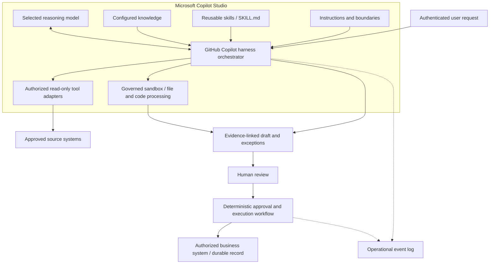
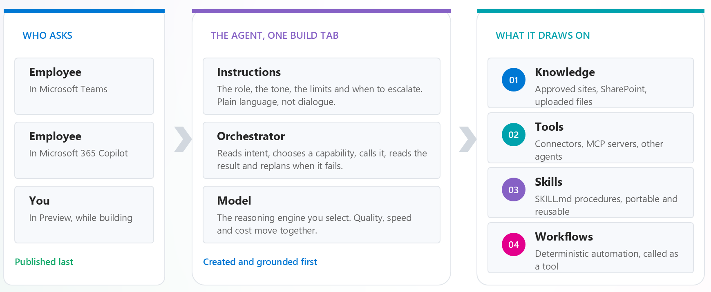
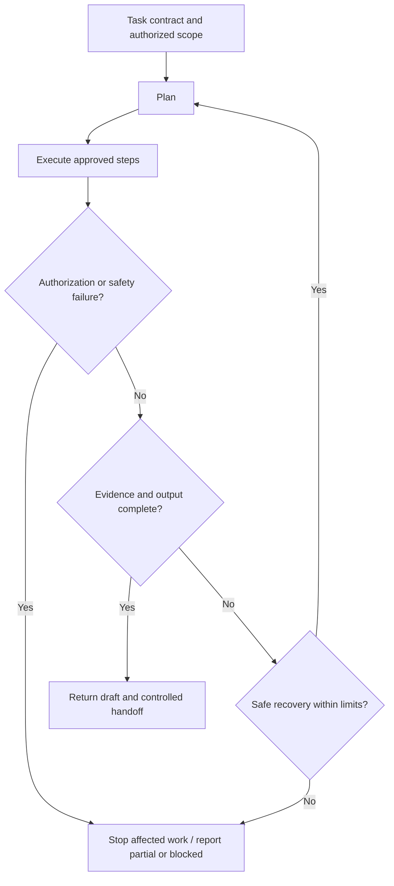

# GitHub Copilot Harness Execution in Copilot Studio

**Official product guidance checked:** 2026-10-11.

## Purpose

Use adaptive planning for bounded business tasks while keeping consequential actions under explicit human and deterministic workflow control.

In this pattern, GitHub Copilot Harness is the authoring and runtime/orchestrator choice inside Copilot Studio. This document does not describe using GitHub Copilot in an IDE, the CLI, the SDK product, or the coding agent.

The builder configures instructions, knowledge, tools, skills, a model, and guardrails. The harness manages context, invokes the model, interprets its responses, and coordinates tools to produce a requested outcome.

## Product Scope and Availability

The harness shares underlying technology and SDK components with GitHub Copilot, but is not the GitHub Copilot service. Customer data from Copilot Studio agent runs isn't sent to or processed by that service. Existing Copilot Studio privacy, security, compliance, and data residency commitments apply.

Select the harness when creating a new agent. Agents can't be transferred between the GitHub Copilot and standard harnesses. Treat a move as a rebuild justified by a scenario-level benefit; existing standard harness agents remain supported.

The product supports authorized action tools, native file processing, skills, optional memory, and connected agents. Read-only tools, mandatory human approval, exact-version checks, and idempotency are additional controls required by this pattern, not automatic harness behavior.

Validate each required feature and publishing channel. Natural-language authoring, created files, memory, and MCP integration have feature-specific preview documentation; an individual feature's preview status doesn't describe the release status of every harness capability.

Native [Hooks (preview)](https://learn.microsoft.com/en-us/microsoft-copilot-studio/agents-experience/hooks-overview) can run policy workflows at lifecycle events, and [Workflow Request for information](https://learn.microsoft.com/en-us/microsoft-copilot-studio/workflows-experience/flows-request-for-information) can pause for human input. Neither automatically implements this pattern's backend authorization, exact-version approval, or duplicate protection.

## When to Use or Avoid

Use this pattern when the route to an outcome varies:

- Evidence must be gathered across several sources.
- Documents require contextual interpretation.
- Intermediate results change the next step.
- Recoverable failures require replanning.
- Multiple outputs must remain consistent.

Prefer a simpler design when a fixed workflow or direct knowledge response is sufficient.

Standard harness agents can also reason, retry, chain tools, and combine AI with deterministic steps. Connectors or MCP alone don't require the GitHub Copilot harness. The differentiators are task scale, shared context, file processing, and adaptive coordination; simple tasks can incur unnecessary latency and credit consumption on a heavier runtime.

A combined design can retain a responsive standard harness front end while a GitHub Copilot harness agent curates large files or prepares structured data in the background. Publish only validated outputs to the shared knowledge/data layer. This is an integration between agents, not a transfer of an existing agent to another harness.

Professional, financial, operational, or safety authority remains with the designated decision-maker. The agent may prepare evidence and options, but cannot acquire that authority through prompting.

## Conceptual Architecture



Original logical diagram grounded in public Microsoft Learn documentation. These are responsibilities, not built-in API names or a physical deployment topology. Backend authorization applies independently of the agent.

The sandbox is governed by Copilot Studio; the diagram doesn't assert a tenant-only network boundary or permanent sandbox storage. Review the selected model, connectors, sources, and processing requirements for the target environment.

## Agent Building Blocks



Use the figure to distinguish the model's reasoning from harness orchestration and the resources configured by the builder. Workflows can be exposed as tools, but an invocation doesn't itself grant approval or bypass backend checks. The illustrative channels and components must still be validated for the target environment.

Adaptive execution can repeat a path; the harness doesn't guarantee a different path on every run. Deterministic workflows fix the authored control path, not the factual correctness of an AI-generated result.

## Reusable Components

| Component | Responsibility |
|---|---|
| Instructions | Define role, outcome, scope, ambiguity handling, forbidden actions, and escalation. |
| Knowledge | Supply approved policies, standards, and trusted records. |
| Tools | Expose narrowly scoped operations with explicit inputs, outputs, and errors. |
| Skills | Package Markdown procedures, output contracts, and optional scripts/resources in `SKILL.md` or a skill bundle. |
| Model | Supply reasoning and generation; choose against measured quality, latency, and consumption. |
| Sandbox file processing | Read and create supported draft files as part of task execution. |
| Optional memory | Retain user-specific context; not the authoritative source, approval ledger, or recovery checkpoint. |
| Optional connected agents | Delegate specialized work when needed; maintain the same scope and authorization boundaries. |
| Hooks (preview) | Run event-driven checks or error guidance; failed Hooks don't stop the agent, so critical rules also need backend enforcement. |
| Workflows | Implement mandatory review and consequential execution, optionally using native Request for information for human input. |

A skill is procedural guidance, not a security boundary or a guarantee of deterministic execution.

## Choosing the Right Component

| Requirement | Put it in | Required validation |
|---|---|---|
| Approved reference context | Knowledge | Source authorization, applicability, freshness, and supported citations. |
| Complete or live version-specific content | A narrowly scoped retrieval tool | Full-document coverage, explicit version metadata, and distinguishable errors. |
| A reusable task procedure and output convention | A skill | Clear activation description, ordered instructions, edge cases, and output checks. |
| A fixed approval, record update, or notification path | A workflow | Independent authority checks, permitted destinations, approval binding, and idempotency. |
| A check before a tool runs or event-based error guidance | A Hook plus independent backend controls | Match the event's response contract and test failure/time-out behavior; a Hook isn't the sole authorization boundary. |

Keep the user prompt outcome-focused. Place enduring role/scope rules in Instructions, references in Knowledge, operations in Tools, repeatable procedure in Skills, and consequential control in Workflows rather than embedding all configuration in every request.

## Execution Cycle

1. Clarify missing critical inputs.
2. Create a bounded plan.
3. Select relevant knowledge, skills, and tools.
4. Execute authorized steps.
5. Verify evidence and output completeness.
6. Replan only when safe and within scope.
7. Return results, uncertainty, and exceptions.
8. Hand consequential decisions to a human or controlled workflow.

Replanning must never expand permissions or bypass a denial.



This original reference-design flow distinguishes recoverable omissions from authorization or safety failures. It is not a runtime state-machine API.

## Design Rules

### Separate reasoning from consequential execution

Keep agent-accessible tools read-only by default.

Place write credentials and consequential operations behind an independently enforced workflow. Apply least privilege and backend access checks.

Record each tool's actual execution identity. [Maker-provided credentials](https://learn.microsoft.com/en-us/microsoft-copilot-studio/configure-no-maker-authentication) can use the connection owner's permissions, not the signed-in requester's. [Remove unneeded connector actions or disable individual MCP tools](https://learn.microsoft.com/en-us/microsoft-copilot-studio/agents-experience/tools-manage) rather than relying on instructions to avoid them.

### Bind approval to an exact action

Record reviewer identity, artifact version or hash, permitted action, destination, and approval expiration.

Modified artifacts invalidate approval. Recheck authorization and relevant source versions before committing.

Native [Request for information](https://learn.microsoft.com/en-us/microsoft-copilot-studio/workflows-experience/flows-request-for-information) supports Outlook requests to same-tenant reviewers and uses the first response only. It isn't automatic all-reviewers approval. A human response must still pass the [custom approval/action-record checks](GitHub-Copilot-Harness-Execution-Runbook.md#custom-approval-and-action-records).

### Bound adaptation

Implement limits for calls, elapsed time, and retries.

Retry recoverable failures only. Stop or escalate on missing authorization, unresolved source conflicts, exhausted limits, or invalid inputs.

For native [Hooks](https://learn.microsoft.com/en-us/microsoft-copilot-studio/agents-experience/hooks-overview), **Pre tool use** can deny a tool call; **Error** and **After tool failure** have different response fields. A failed or timed-out Hook lets the agent continue. Keep important limits and action gates independently enforced; see the [event contracts and enforcement split](GitHub-Copilot-Harness-Execution-Runbook.md#native-hooks-and-independent-enforcement).

### Treat retrieved content as data

Documents, messages, and tool responses may contain malicious instructions. They cannot redefine the agent's role, grant permissions, or authorize actions.

### Make incomplete work visible

Distinguish complete, partial, and blocked analytical results. Identify missing sources and unperformed steps.

A completed analysis does not mean that a proposed business action has occurred.

### Recover without duplicating effects

Resume only when durable state and recovery semantics have been implemented.

Recheck source versions after pauses. Use persistent idempotency and outcome reconciliation for consequential operations.

The [native Workflow pause for human input](https://learn.microsoft.com/en-us/microsoft-copilot-studio/workflows-experience/flows-request-for-information) is not a guarantee of arbitrary agent-run recovery. Revalidation is required after either a human wait or an unexpected interruption.

### Preserve artifacts outside conversation retention

[Created files](https://learn.microsoft.com/en-us/microsoft-copilot-studio/agents-experience/created-files-overview) are limited to 10 MB per file and retained for 28 days after the conversation's last activity. Oversized files aren't surfaced in the response. Split deliverables, verify that every required output is available, and use an authorized intake/workflow to preserve accepted artifacts in approved persistent storage.

Optional [Memory](https://learn.microsoft.com/en-us/microsoft-copilot-studio/agents-experience/memory-overview) is per user and per agent. It doesn't replace a versioned business record, approval ledger, or implemented recovery state. Don't make this pattern depend on memory being available in every channel.

If accepting [user attachments](https://learn.microsoft.com/en-us/microsoft-copilot-studio/agents-experience/attachments-overview), account for the separate 16 MiB per-file limit and the behavior that a failed attachment is skipped while the message continues. Validate mandatory input coverage rather than equating a processed turn with complete analysis; backend retrieval has its own limits.

## Example Output Contract

The following is illustrative, not a platform schema:

```yaml
run_id: example-run
status: partial
artifact:
  id: review-draft
  version: "3"
findings:
  - statement: "A deviation requires review."
    evidence:
      - source_id: approved-document
        version: "7"
        location: "Section 4"
exceptions:
  - "One required source was unavailable."
proposed_actions:
  - "Submit the draft for qualified review."
handoff:
  owner_role: business-owner
  approval_required: true
```

## Scenario Applications

| Application | Inputs and outputs | Retained control |
|---|---|---|
| RFP response preparation | Requirements and approved answers become a response draft. | Commercial, pricing, and submission approval. |
| Incident post-mortem | Logs, tickets, and conversations become a timeline and draft findings. | Humans own conclusions and production changes. |
| Contract review | Contract and approved standards become deviations and draft fallback wording. | Qualified legal review; no autonomous signing. |
| Disruption planning | Resource and operating constraints become plan/replan options. | Humans own operational and safety decisions. |

## Metrics

Agree thresholds before the pilot for:

- Evidence-supported findings.
- Output-contract validity.
- Reviewer acceptance and correction rate.
- Correct escalation.
- Tool failures and recovery.
- Latency and observable run cost.
- Unauthorized or duplicate consequential effects.

These are proposed measures, not achieved ROI.

The [Agent Evaluate tab's General quality method](https://learn.microsoft.com/en-us/microsoft-copilot-studio/agents-experience/analytics-agent-evaluation-intro) doesn't compare responses to expected answers. Keep qualified domain review, source fidelity, and control tests separate from that score. Likewise, [Monitor session/run success](https://learn.microsoft.com/en-us/microsoft-copilot-studio/agents-experience/analytics-overview#overview-metrics) isn't a legal-accuracy metric.

## Consumption and Cost Controls

AI-assisted creation, preview/testing, evaluation, and runtime can consume Copilot Credits. Consumption includes model tokens, tools/knowledge/MCP, and the harness. GitHub Copilot harness agent usage isn't included with a user's Microsoft 365 Copilot license; plan capacity before AI-assisted building or testing.

The Power Platform admin center provides an agent monthly limit with an optional **Stop usage** control. Enable that control when the limit must stop usage; a notification threshold alone isn't a hard stop.

An environment's prepaid allocation isn't a complete consumption boundary if it can draw from unallocated tenant capacity or a linked pay-as-you-go plan. Azure budgets and alerts notify but don't stop Copilot Studio consumption. Document the allocation, tenant-pool draw, billing plan, and agent stop settings together.

These monthly/capacity controls are distinct from the per-run call, elapsed-time, and retry limits in this design. Implement and verify those run limits separately rather than assuming that a monthly budget terminates a task at an exact per-run cost.

## Official References

Public product documentation checked on 2026-10-11. Custom schemas, diagrams, thresholds, and approval controls in this document are reference-design guidance, not built-in product contracts or executed acceptance evidence.

- [Harnesses in Copilot Studio](https://learn.microsoft.com/en-us/microsoft-copilot-studio/harnesses-overview)
- [Agents powered by the GitHub Copilot harness overview](https://learn.microsoft.com/en-us/microsoft-copilot-studio/agents-experience/overview)
- [Compare Copilot Studio agent harnesses](https://learn.microsoft.com/en-us/microsoft-copilot-studio/guidance/choose-harness)
- [Skills overview for agents](https://learn.microsoft.com/en-us/microsoft-copilot-studio/agents-experience/skills-overview)
- [Workflows overview](https://learn.microsoft.com/en-us/microsoft-copilot-studio/workflows-experience/flows-overview)
- [Overview of usage-based billing](https://learn.microsoft.com/en-us/microsoft-copilot-studio/agents-experience/billing-credit-overview)
- [Manage costs for agents powered by the GitHub Copilot harness](https://learn.microsoft.com/en-us/power-platform/admin/manage-usage-github-copilot-harness)
- [Hooks](https://learn.microsoft.com/en-us/microsoft-copilot-studio/agents-experience/hooks-overview)
- [Request information from human review in workflows](https://learn.microsoft.com/en-us/microsoft-copilot-studio/workflows-experience/flows-request-for-information)
- [Control maker-provided credentials](https://learn.microsoft.com/en-us/microsoft-copilot-studio/configure-no-maker-authentication)
- [Manage tools and actions](https://learn.microsoft.com/en-us/microsoft-copilot-studio/agents-experience/tools-manage)
- [Attach files to a conversation](https://learn.microsoft.com/en-us/microsoft-copilot-studio/agents-experience/attachments-overview)
- [Evaluate an agent](https://learn.microsoft.com/en-us/microsoft-copilot-studio/agents-experience/analytics-agent-evaluation-intro)

## Related Guidance

- [Execution Runbook](GitHub-Copilot-Harness-Execution-Runbook.md)
- [Contract Review Scenario](../../01-scenarios/Contract-Review-GitHub-Copilot-Harness-Agent/1.Overview.md)
- [Human-in-the-Loop Review and Approval](https://github.com/microsoft/ai-agent-runbooks/blob/main/02-patterns/Human-in-the-Loop-Review-and-Approval/Human-in-the-Loop-Review-and-Approval.md)
- [MCP Server Integration](https://github.com/microsoft/ai-agent-runbooks/blob/main/02-patterns/MCP-Server-Integration/MCP-Server-Integration.md)

Related patterns provide complementary guidance. Confirm control applicability in the target environment.
