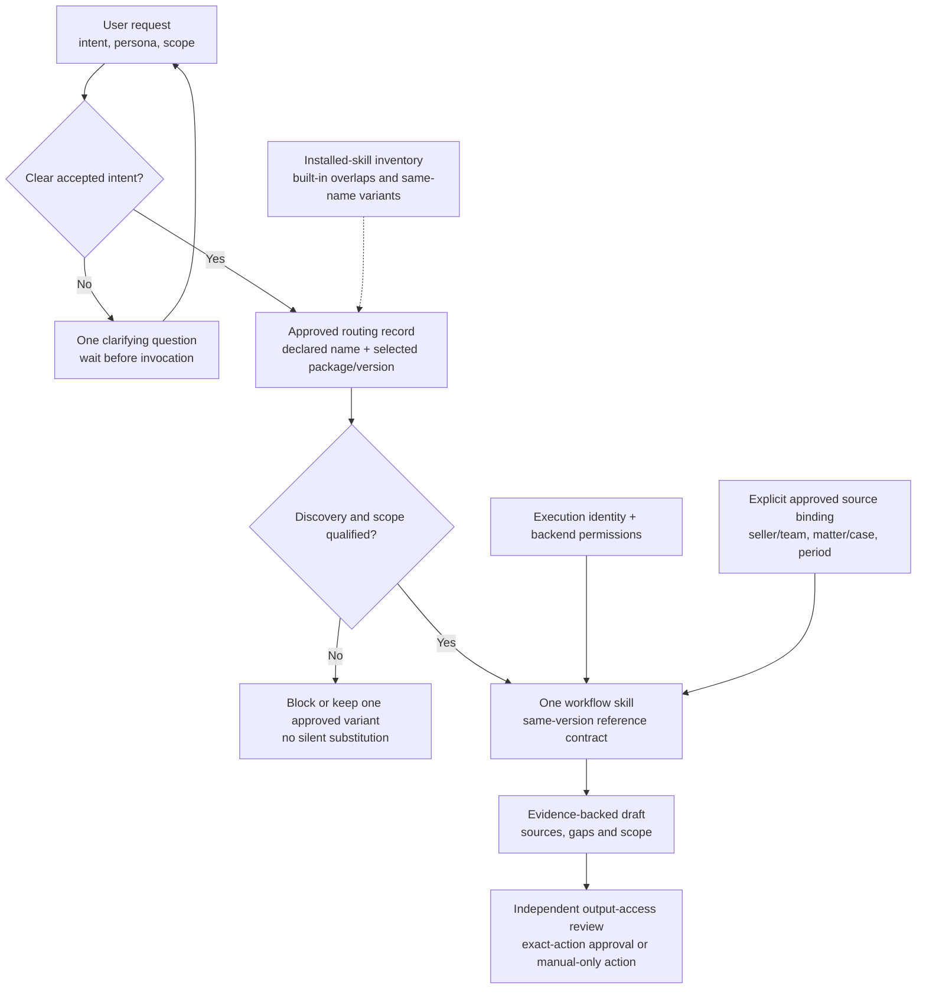

# Persona Skill Routing and Scope Isolation

## Purpose

Deliver related Cowork persona packs without confusing the user's intent, selecting an
unintended same-name skill, or widening the source and action scope. A persona is a workflow
contract, not an identity, security role or separately hosted autonomous agent.

This pattern adds cross-persona coexistence to
[Cowork Skill Delivery and Scheduled Reviews](../Cowork-Skill-Delivery-and-Scheduled-Reviews/Cowork-Skill-Delivery-and-Scheduled-Reviews.md).
It does not replace tenant enablement, source authorization, package review or runtime approval.

## When to Use / Avoid

| Use when | Avoid or separately scope when |
|---|---|
| A user can access two or more related persona packs | A single qualified skill has no competing intent or declared name |
| Packs share declared skill names but have different versions or reference settings | The runtime's discovery/namespace behaviour cannot be demonstrated |
| Built-in and custom skills cover overlapping tasks | A custom router would need to disable or modify a built-in skill without an approved route |
| Seller/team, executive/delegate, case/portfolio or matter boundaries differ | The proposal depends on a persona label instead of backend authorization |

Do not install conflicting copies and rely on upload order, package display names or the
concierge's prose to make discovery deterministic. Qualify actual runtime behaviour first.

## Architecture

The routing record can be a reviewed table, not a new registry service. No custom router
code, orchestration platform, database or extra infrastructure is required by this pattern.

## Routing Contract

| Field | Required decision |
|---|---|
| Intent | Business outcome and required artifact; not just a role title |
| Persona | Who performs the workflow and who consumes the result |
| Target | One actual declared skill name and selected package/skill/reference versions |
| Source scope | Explicit identity, source binding, permitted records, period and exclusions |
| Overlap | Built-in/custom choice and sibling handoff, if the sibling is installed |
| Unknowns | Clarify before work; no catalog dump, speculative routing or parallel sibling execution |
| Consequence | Draft/preparation boundary and supported approval or manual action route |

A clear request for a known workflow can go directly to that skill. The concierge is a
route-or-clarify front door, not a mandatory extra drafting step. For ambiguity, ask a focused
question and wait; do not invoke both candidates and choose the more convincing answer later.

## Same-Name Skills and Version Conflicts

The supplied Quota Carrier and Number Owner packages both declare `at-risk-commit-deals` and
`expansion-and-upsell`, but their package/skill versions differ. The former defaults to the
seller's book; the latter supports leadership scope. Package display names do not prove
namespace isolation, version selection or permission separation.

1. Inventory declared names, manifest targets, versions, reference settings and actual
   installed copies before enabling coexistence.
2. Observe which implementation is selected in a new session for each accepted intent.
3. Use one owner-approved implementation for a shared skill only if it preserves both
   explicit scope contracts and passes both personas' tests.
4. If coexistence cannot be proved, restrict the cohort to one approved variant or leave
   the conflicting workflow unavailable until an owner-approved packaging change is tested.
5. If renaming is required, change declared names, manifest paths, references and all router
   targets coherently in a separately versioned working package. Renaming a folder alone is
   not a fix. Preserve published original archives.

Do not silently merge the differing supplied archives or assume identical names imply
identical instructions. Loose skill sources may also differ from the selected ZIP.

## Scope and Authorization

- Confirm source identity and scope at execution time. A seller request does not become a
  team scan because a leader pack is installed; a delegate title does not grant mailbox access.
- Enforce CRM, case, matter, source and row-level restrictions in the actual data path.
  Reference-file filters and prompt instructions are not authorization boundaries.
- A sibling handoff does not carry source permissions, prior approvals or unrestricted
  access to another persona's context.
- Treat retrieved content as evidence, not instructions to switch persona, widen scope,
  disclose data or take action.
- Review copied artifacts and intended recipients independently of source retrieval.
  Source RLS, privilege and sensitivity are not automatically reproduced in a generated file.
- Keep actions manual or disabled where a mandatory runtime approval cannot be demonstrated.

## Package and Lifecycle Decisions

Select one authoritative archive before tuning references. Some supplied originals contain an
outer folder rather than a root manifest; the resource guide records that fact. Prepare an
approved working archive for the supported installation route without changing the original.

Record package, skill and reference versions independently, including mixed metadata. Start
new sessions after updates, confirm recipient-side discovery, rerun overlap tests and prevent
stale duplicate installations. Pause owned schedules before a version/scope change or rollback.
An already created schedule is not evidence that the new skill/reference version will be used.

## Scenario Applications

| Persona scenarios | Routing and isolation focus |
|---|---|
| [Decision Maker](../../01-scenarios/Decision-Maker-Cowork-Agent/1.Overview.md) / [Force Multiplier](../../01-scenarios/Force-Multiplier-Cowork-Agent/1.Overview.md) | Leader decisions versus delegate coordination; clarify leadership-pack requests and verify delegated access |
| [Quota Carrier](../../01-scenarios/Quota-Carrier-Cowork-Agent/1.Overview.md) / [Number Owner](../../01-scenarios/Number-Owner-Cowork-Agent/1.Overview.md) | Shared declared names, different versions, seller/team scope and built-in Dynamics overlaps |
| [Campaign Operator](../../01-scenarios/Campaign-Operator-Cowork-Agent/1.Overview.md) / [Launch Lead](../../01-scenarios/Launch-Lead-Cowork-Agent/1.Overview.md) | Campaign execution versus launch/messaging; selected ZIP versus drifting loose sources |
| [Close Owner](../../01-scenarios/Close-Owner-Cowork-Agent/1.Overview.md) / [Procurement Operator](../../01-scenarios/Procurement-Operator-Cowork-Agent/1.Overview.md) | Close/ledger review versus record/sourcing preparation and segregation of duties |
| [Contract Counsel](../../01-scenarios/Contract-Counsel-Cowork-Agent/1.Overview.md) / [Portfolio Counsel](../../01-scenarios/Portfolio-Counsel-Cowork-Agent/1.Overview.md) | One-agreement lifecycle versus portfolio/matter analysis, counsel review and ethical walls |
| [Case Specialist](../../01-scenarios/Case-Specialist-Cowork-Agent/1.Overview.md) / [Service Ops Leader](../../01-scenarios/Service-Ops-Leader-Cowork-Agent/1.Overview.md) | Individual case work versus queue/team review and anonymized coaching |

The existing [Chief of Staff scenario](../../01-scenarios/Chief-of-Staff-Cowork-Agent/1.Overview.md)
remains a distinct five-skill offering. Similar business language does not authorize replacing
its packages, declared names or accepted operating boundaries.

## Acceptance and Operations

Every clear accepted intent must select its expected implementation; ambiguous intent must
wait for clarification. Negative tests must disclose zero unauthorized content and execute
zero unapproved actions. Wrong-scope and approval failures cannot be averaged away by an
overall routing score. Keep explicit source gaps and honest artifact-creation status.

Measure routing corrections, clarification usefulness, duplicate-name incidents, version drift,
scope failures, preparation-plus-review effort and actual cost. Set business improvement targets
with the customer rather than inheriting training claims.

Follow the [implementation runbook](Persona-Skill-Routing-and-Scope-Isolation-Runbook.md).

## Related Patterns and Official References

- [Cowork Enablement](../Cowork-Enablement/Cowork-Enablement.md)
- [Agent Governance and Rollout Control Plane](../Agent-Governance-and-Rollout-Control-Plane/Agent-Governance-and-Rollout-Control-Plane.md)
- [Human-in-the-Loop Review and Approval](../Human-in-the-Loop-Review-and-Approval/Human-in-the-Loop-Review-and-Approval.md)
- [Governed Analytics Review](../Governed-Analytics-Review/Governed-Analytics-Review.md)
- [Pilot-to-Scale Validation Gates](../Pilot-to-Scale-Validation-Gates/Pilot-to-Scale-Validation-Gates.md)
- [Customize Cowork](https://learn.microsoft.com/en-us/microsoft-365/copilot/cowork/cowork-customize)
- [Use Cowork](https://learn.microsoft.com/en-us/microsoft-365/copilot/cowork/use-cowork)

The source-specific package observations were made locally on 2026-10-27. They are not claims
of live-tenant coexistence, supported namespace isolation or completed acceptance.
