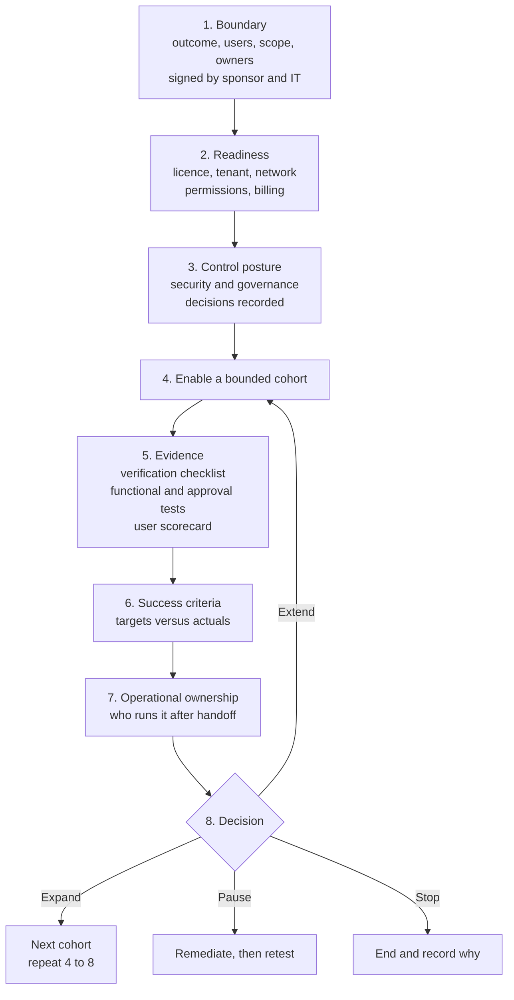

# Pilot-to-Scale Validation Gates

> **Scale is a decision with evidence, not a consequence of a successful demo.** A pilot
> earns expansion by meeting criteria agreed before it started, with owners who can say yes.

---

## Why This Pattern

| Signal | Evidence |
|---|---|
| **Industries** | All |
| **Where it appears** | Any agent or Copilot capability moving from a cohort to a department or tenant |
| **Typical trigger** | "The pilot went well, so roll it out" without agreed criteria, ownership or cost data |
| **Symptom in the field** | Support, security or cost problems appear only after rollout; nobody can say what "success" meant; pilot users and sponsors disagree about value |

The pattern defines the structure of a Cowork-style pilot: a signed boundary, readiness and
control gates before users are enabled, a small evidence-producing test set, success
criteria with targets, an ownership matrix, and a recorded decision.

---

## The Gate Sequence

Each gate has an owner, a deliverable and a stop condition. A failed gate blocks the next
one; it is not carried forward as a known issue.

---

## Design Rules That Hold Up

### 1. Sign the boundary first

Record the outcome, users, use cases, explicit exclusions, data in scope, excluded data classes,
billing owner and support owner. If audience, outcome or billing owner is unknown, stop.

### 2. Put stop conditions in the plan

If security cannot approve the control posture, do not enable users. If funding is unknown, do
not open discovery. Writing the stop in advance removes the pressure to proceed.

### 3. Test small and representative

Choose a short set of tests that exercise access, files, approvals, scheduling, policy
boundaries and cost behaviour. Do not run broad destructive actions in production. Each test
has a prompt, an expected result, evidence and a reviewer.

### 4. Separate critical from non-critical criteria

Some criteria are binary and blocking: access works, sensitive actions stop for approval, no
high-severity security issue, pilot users are in the intended cost policy, an owner accepts
support. Others are judged: satisfaction, cost against threshold. Do not average a critical
failure away.

### 5. Define targets before measuring

Targets for satisfaction, cost and value are **customer-defined and set before the pilot**.
Time saved is a user-reported figure until a baseline method is agreed. Do not publish a
saving that the pilot did not measure.

### 6. Verify controls rather than describing them

An approval, a block or a limit is a claim until observed. The verification checklist and
tests exist to turn "configured" into "demonstrated".

### 7. Assign run-state ownership before handoff

Access and licences, agent and skill review, billing and cost review, policies and limits,
alerts and variance, reconciliation, limit requests, security monitoring, support,
adoption and the scenario backlog each need an owner and a cadence.

### 8. Record one of four decisions

| Decision | When |
|---|---|
| **Expand** | Exit criteria met, billing accepted, policy coverage validated, support ready, sponsor approves |
| **Extend pilot** | Minor issues remain, or more usage, value or cost data is needed |
| **Pause** | A security, billing, cost-control or reliability issue needs remediation |
| **Stop** | Value not proven, or risk unacceptable |

Expansion repeats the gates for the new cohort; it does not inherit the previous approval.

---

## Evidence Pack

| Artifact | Gate |
|---|---|
| Engagement boundary statement | 1 |
| Requirement validation table, licence confirmation, technical readiness | 2 |
| Risk and assumptions log | 2 |
| Security review decision table, governance review record | 3 |
| Policy decision log, access assignment record | 3, 4 |
| Verification checklist and functional test results | 5 |
| User testing scorecard | 5 |
| Success criteria record | 6 |
| Operational ownership matrix | 7 |
| Expansion decision record | 8 |

---

## Real-World Scenarios

### Scenario A - Rollout without criteria
Leaders asked to scale after an enthusiastic demo. No targets existed. **Response:** write
criteria retrospectively with the sponsor, run the missing tests and decide on evidence.
Retrofitting is harder than setting them first.

### Scenario B - Critical test fails
An approval card did not appear for one action type. **Response:** pause expansion, remediate
the policy, retest and record the retest, rather than noting it as a known issue.

### Scenario C - Good satisfaction, poor cost fit
Users liked the pilot but consumption was well above forecast. **Response:** extend the
pilot, tighten limits and retest the cost criterion before any expansion.

### Scenario D - No owner after handoff
Everything worked but nobody owned support or policy review. **Response:** complete the
ownership matrix and obtain acceptance before expansion.

These are illustrative situations to design against, not reported customer outcomes.

---

## When to Use / Avoid

| Use this pattern when | Do not use it when |
|---|---|
| Moving a Copilot or agent capability beyond a first cohort | A trivial, reversible experiment with no data, cost or action risk |
| Sponsors, security and finance all need to agree | A formal change-management process already supplies identical gates (map to it instead) |
| The capability can act on behalf of users or consume budget | The question is only how to build the agent |

---

## Metrics Worth Tracking

| Metric | Why |
|---|---|
| Critical tests passed at first attempt | Indicates configuration quality |
| Time from boundary signed to decision | Shows process drag, not product speed |
| Users completing two approved scenarios | Tests adoption readiness |
| Cost versus pilot threshold | Informs the scale decision |
| Open high-severity issues at decision | Must be zero to expand |
| Decisions that reversed after expansion | Reveals weak gates |

---

## Related Patterns and Scenarios

- Runbook: [Pilot-to-Scale-Validation-Gates-Runbook.md](Pilot-to-Scale-Validation-Gates-Runbook.md)
- [Cowork Spending Policies and Cost Governance](../Cowork-Spending-Policies-and-Cost-Governance/Cowork-Spending-Policies-and-Cost-Governance.md)
- [Agent Governance and Rollout Control Plane](../Agent-Governance-and-Rollout-Control-Plane/Agent-Governance-and-Rollout-Control-Plane.md)
- [Human-in-the-Loop Review and Approval](../Human-in-the-Loop-Review-and-Approval/Human-in-the-Loop-Review-and-Approval.md) - verifying approval behaviour
- [Cowork Skill Delivery and Scheduled Reviews](../Cowork-Skill-Delivery-and-Scheduled-Reviews/Cowork-Skill-Delivery-and-Scheduled-Reviews.md)
- Scenario: [Cowork Enablement Pilot](../../01-scenarios/Cowork-Enablement-Pilot/1.Overview.md)

---

## Reference Documentation

- [Copilot Cowork overview](https://learn.microsoft.com/en-us/microsoft-365/copilot/cowork/)
- [Microsoft Copilot adoption resources](https://adoption.microsoft.com/copilot)
- [Manage agents in the Microsoft 365 admin center](https://learn.microsoft.com/en-us/microsoft-365/admin/manage/manage-copilot-agents-integrated-apps)
